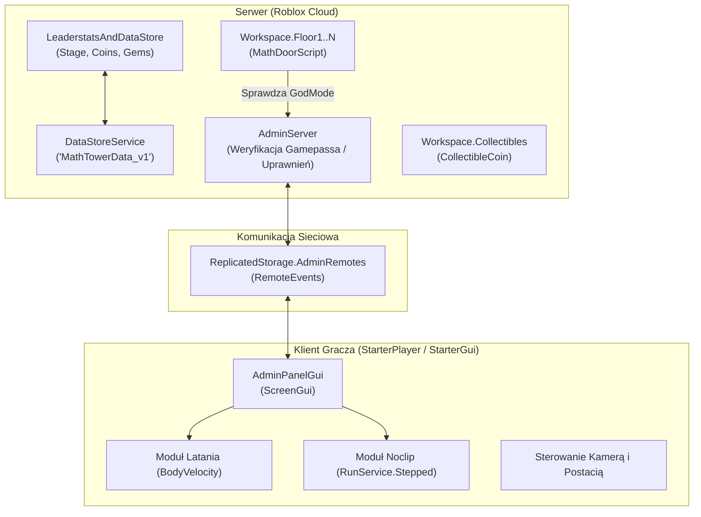

> **Stan istniejącego prototypu v1.** Ten dokument opisuje obecny kod klient/serwer i nie oznacza, że nowy świat Siedlec jest zaimplementowany. Docelowy pipeline i wymagania skali: [tech/CONTENT_PIPELINE.md](tech/CONTENT_PIPELINE.md), [tech/LARGE_WORLD.md](tech/LARGE_WORLD.md); aktualna wizja w [GDD.md](GDD.md).

# 🏗️ Math City — architektura techniczna

Dokument opisuje architekturę systemu gry, podział na stronę klienta i serwera oraz przepływ danych w silniku Roblox (Luau).

Magazyn `MathTowerData_v1` zachowuje starszy identyfikator dla zgodności z istniejącymi zapisami Math City.

---

## 1. Diagram Architektury Systemu



---

## 2. Podział Odpowiedzialności (Client-Server Boundary)

### Serwer (`src/server/`):
* **`LeaderstatsAndDataStore.luau`**:
  * Jedno źródło prawdy dla stanu gracza (`Stage`, `Coins`, `Gems`).
  * Bezpieczny zapis i odczyt z chmury Roblox (`DataStoreService:GetAsync` / `SetAsync`).
  * Automatyczna obsługa `PlayerAdded`, `PlayerRemoving` oraz `game:BindToClose`.
  * Połączenie z eventem `CharacterAdded` i repozycjonowanie `HumanoidRootPart` do odpowiedniego klocka w `workspace.Checkpoints`.
* **`MathDoorScript.luau`**:
  * Działa niezależnie w każdym modelu piętra (`Floor1`, `Floor2` itd.).
  * Obsługuje zdarzenie `Touched` dla klocków `Door1`, `Door2`, `Door3`.
  * Weryfikuje atrybut `player:GetAttribute("GodMode")` przed zresetowaniem zdrowia gracza.
  * Zmienia właściwości `CanCollide`, `Transparency` i `Color` w sposób synchroniczny dla wszystkich graczy.
* **`AdminServer.luau`**:
  * Bezpieczna autoryzacja uprawnień: gracz nie może oszukać serwera, bo serwer sprawdza `MarketplaceService:UserOwnsGamePassAsync` lub `game.CreatorId`.
  * Wykonuje polecenia zmiany `WalkSpeed`, modyfikacji zdrowia (`MaxHealth = math.huge`) oraz dodawania walut.

### Klient (`src/client/`):
* **`AdminPanelGui.luau`**:
  * Dynamicznie tworzy interfejs graficzny (`ScreenGui`) z zaokrąglonymi rogami (`UICorner`).
  * Obsługuje pętlę `RunService.RenderStepped` dla płynnego latania w 3D bazując na wektorach kamery `cam.CFrame.LookVector` oraz klawiszach WASD.
  * Obsługuje pętlę `RunService.Stepped` dla wyłączania kolizji (`part.CanCollide = false`) na częściach ciała postaci w trybie **Noclip**.

---

## 3. Przepływ Danych przy Odradzaniu (Checkpoint System)

1. Gracz dołącza do gry ➡️ Serwer pobiera z bazy danych wartość `Stage` (np. 5).
2. Postać gracza zostaje wygenerowana (`CharacterAdded`).
3. Serwer wyszukuje klocek o nazwie `"5"` w folderze `workspace.Checkpoints`.
4. Serwer ustawia pozycję gracza:
   ```lua
   hrp.CFrame = currentCheckpoint.CFrame + Vector3.new(0, 3.5, 0)
   ```
5. Jeśli gracz dotknie błędnych drzwi, postać ginie (`Health = 0`) i proces odradzania powtarza się w bezpiecznym punkcie poziomu 5!