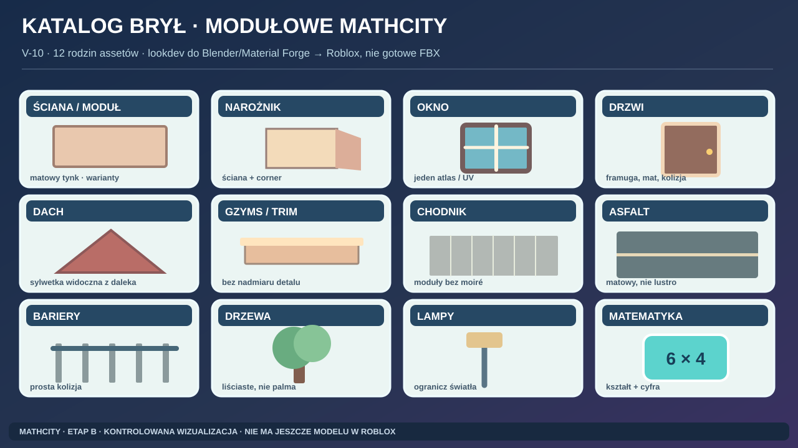

# B6 — modularny kit do przyszłej produkcji Roblox

## Obrazkowy katalog dwunastu rodzin brył

Wzorzec pokazuje kolor, sylwetkę i ponowne wykorzystanie elementów. Nie stanowi dowodu, że przygotowano model 3D, atlas UV lub zaimportowano asset do Roblox.

**Status:** projekt reguł modelowania. Nie wykonano assetów ani benchmarków. Narzędzia YACS (UE/Blender/Material Forge) są tylko środowiskiem produkcji treści. Roblox to runtime.

## Źródła technologiczne

[R05] pojedynczy mesh ≤20 000 tris; [R06,R07] MeshPart, jedna materiałowa powierzchnia i UV 0–1, OpenGL tangent-space normal map; [R08,R09] FBX/glTF, Y-up i Z-up; [R10,R12] reuse/streaming, pomiar w rzeczywistym kliencie. Szczegóły i URL w [SOURCE_REGISTER](SOURCE_REGISTER.md).

## Zasady systemu

1. Jeden budynek = wiele powtarzalnych modułów zamiast jednego gigantycznego modelu. Przechowuj tag źródła i licencji.
2. Zabytek: **osobna bryła ikony / hero asset** dla rozpoznawalności, otoczenie zabytku z kitów, a nie losowy prefab.
3. Jeden mesh = jeden zestaw materiałowy (Atlas lub osobne części), UV 0–1. Nie zakładaj multi-material jak w UE.
4. **PBR z Material Forge**: ColorMap/NormalMap/RoughnessMap/MetalnessMap (+ ewentualna emissive) testowane osobno. Dla normal map wymagany OpenGL tangent-space.
5. Traktuj „UV, materiał, pivot, skala” jako część kontraktu późniejszego eksportu, ale nie ustawiaj ich bez wizji lokalnej i pierwszego testu.
6. **LOD na widoku świata:** hero, close, mid, silhouette; później sprawdź SLIM, RenderFidelity i streaming (nie zakładaj ręcznego, uniwersalnego pipeline'u LOD w każdej sytuacji).
7. Liczba draw calls, trójkątów sceny, obciążenie GPU, rozmiar tekstur = **MEASURE_LATER**. Nie przyjmuj magicznych „100 tris” dla lampy bez kontekstu.

## Katalog rodzin

| KIT | Warianty | Wspólna tekstura | Kolizja (plan) | Daleki poziom szczegółu | FAIL gdy |
|---|---|---|---|---|---|
| KIT-WALL | tynk, cegła, niski parter, witryna | fasady i trim sheet | prosty box | bez detalu okien | widoczne szwy |
| KIT-CORNER | wewnętrzny, zewnętrzny | ten sam co WALL | box | niska bryła | narożnik nie łączy się |
| KIT-WINDOW | niski, wysoki, witryna, łuk | szyba/okiennice | brak lub płaski box | baked kolor okna | szyba jak lustro |
| KIT-DOOR | zwykłe, sklep, interakcja | drewno/szkło | uproszczona rama | zamknięty kształt | brak czytelnego wejścia |
| KIT-ROOF | dachówka, blacha, dach płaski | 2–3 atlasy | zwykle brak | jednolita połać | dachy zasłaniają landmark |
| KIT-TRIM | cokół, gzyms, pilaster | pasek trim | brak | tylko hero | nadmiar powielonych detalów |
| KIT-PAVEMENT | bruk, płyta, park | atlas podłoża | teren/parts | jednolita nawierzchnia | moiré / zbyt drobny szum |
| KIT-ROAD | asfalt, pasy, krawężnik | asfalt + linie | prosty box | pas koloru | lustrzana droga |
| KIT-FENCE | park, most, stadion | metal/drewno | prosty box | bez prętów | prześwity ukryte |
| KIT-GREEN | 3 korony, krzewy, kwiaty | wspólne liście | pień prosty | kształt korony | tropikalna dżungla na Sekule |
| KIT-LAMP | historyczna, parkowa, sportowa | metal i klosz | box przy nodze | siluetka | za dużo lokalnych świateł |
| KIT-URBAN | ławka, kosz, donica, przystanek | urban shared | prosty box | bryła podstawowa | zbyt wiele materiałów |
| KIT-MATH | figura, bramka, symbol, tablica | własny atlas UI/gry | zależnie od mechaniki | ikona nad obiektem | znaczenie wyłącznie po kolorze |
| KIT-SPORT | krzesło trybun, pachołek, tor, liny | kolorowy kit | prosty box | grupy jako kolor | S01/S03 pomylone |
| KIT-WATER | pomost, barierka, boja, roślina brzegu | drewno/metal | barierki box | odległa sylwetka | fantazja przedstawiona jako realny zalew |

## Nazewnictwo przyszłych assetów (nie tworzyć teraz)

`MC_<DISTRICT>_<KIT>_<OBJECT>_<VARIANT>_vNN`, np. `MC_JACKOWO_WALL_TYNK_A_v01` i `MC_MUCHAWKA_URBAN_POMOST_A_v01`.

Każda karta assetu: ID, POI real/fantasy, source_url, rights_status, intended_blender_scale, origin/pivot, material slots=1 per mesh, texture refs, color swatches, expected LOD, collision intent, reuse candidates, owner, import test NOT_DONE.

## Procedura prototypu późniejszego (Etap E, NIE uruchamiać w B)
- Zrobić prosty fragment ściany ratusza.
- W Blender sprawdzić skalę i oś, UV, materiał.
- Eksport do glTF/FBX; w Roblox Studio sprawdzić warnings.
- Porównać dwa LightingStyle i mobile. Zmierzony koszt, screen i link do raportu.
- Dopiero po teście zatwierdzić liczbowe budżety.

**Nie kopiuj surowych assetów Fab z YACS do publicznego repo**, nawet jeśli licencja dopuszcza pracę z projektem. Audit P02 i poszczególne warunki [RIGHTS](../legal/RIGHTS_AND_COMPLIANCE.md).
