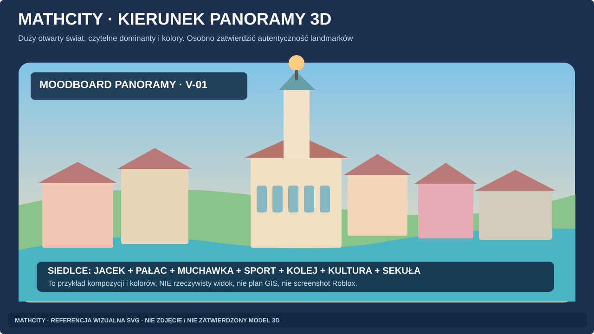

# B5 — 23 pełne karty kadrów do wykonania przez lekkie modele

**Stan:** KARTY OPISOWE, nie gotowe obrazy. Wszystkie realizacje oznaczać `CONCEPT_ART_AI`, `CONCEPT_ART_3D` lub `ROBLOX_SCREENSHOT` zgodnie z rzeczywistym narzędziem. Katalog [CONCEPT_SHOTS.md](CONCEPT_SHOTS.md) i [PHOTO_REFERENCES.md](../world/atlas/PHOTO_REFERENCES.md) są nadrzędne przy kwestii realnych referencji.

**Wspólne wymagania:** proporcje 16:9 dla panoram, 4:3 dla kart miejsc oraz osobny telefon dla V09 (wartości projektowe, nie wymóg techniczny); postacie stylizowane, własne UI bez cudzych znaków; prawdziwe sylwetki mają co najmniej 3 rozpoznawalne cechy. Wszystkie propozycje realnej geografii oznaczać do weryfikacji; zero nieautoryzowanych zdjęć w repo.

## Referencje wzrokowe do wszystkich V-ID (nie tylko prompty)

**[OBOWIĄZKOWE: VISUAL_REFERENCE_ATLAS.md](VISUAL_REFERENCE_ATLAS.md)** zawiera obrazy SVG oraz mapę **V-01→REF00/REF16, V-02→REF01/REF03, ... V-23→REF02/REF05**. Otwórz odpowiednie referencje przed pisaniem każdej karty. W tym pliku pozostają **23 karty**, a SVG pokazują kierunek artystyczny, nie zastępują finalnych renderów. V-13 nadal `BLOCKED_GEOLOCATION`, choć możliwy jest wyłącznie abstrakcyjny fantastyczny moodboard.

## Instrukcja jednej karty

Dla wybranego Vxx skopiuj niższą kartę do promptu. Przeczytaj linki do prawdziwych miejsc Lxx i opis pozostałych elementów z dzielnic. Zachowaj `CAMERA_LOCK`, jeśli porównujesz warianty. Nie dopisuj istniejących obiektów, których źródła nie potwierdzają. Każda wizualizacja wymaga ręcznej kontroli: postaci, kształt, 3 cechy landmarku, źródła i status.

### V-01 — Panorama 7 stref

- **POI_IDS:** C01,C02,C03,N01,N04,N05,S01,S02,T01; **DISTRICT:** całe MathCity; **REFERENCE:** L01,L02,L03,L06,L09,L10,L12; **RIGHTS:** UNKNOWN / LINK_ONLY.
- **CAMERA_LOCK:** AERIAL-01: szeroka panorama 3/4, centrum ratusz jako kotwica; **DAYPART:** day; **SEASON:** all; **ASPECT:** 16:9 (V09 dodatkowo desktop+mobile, V10 arkusz 4:3).
- **THREE_RECOGNITION_FEATURES:** 1) wieża Jacka; 2) pałac i park; 3) zalew i leśna Sekuła, sport i dworzec.
- **FICTIONAL_ELEMENTS:** fikcyjne skróty i kolejność dzielnic; bez udawania mapy 1:1.
- **FOREGROUND:** czytelna lokalna interakcja i element skali postaci; **MIDGROUND:** główny temat; **BACKGROUND:** tożsamość dzielnicy / kontekst.
- **PLAYER_ACTIVITY / MATH:** wyobrażony układ całej gry; ikony aktywności czytelne z daleka.
- **ART:** kolorowy styl S1/S2/S3 z [ART_BIBLE](ART_BIBLE.md), matowy PBR, bez kopiowania cudzych postaci/UI. Zachowaj negatywy globalne.
- **NEGATIVE / AUTOMATIC FAIL:** centrum w środku i naturalny pierścień; siedem stref nie sześć.
- **IMAGE_STATUS:** PROMPT_READY_IMAGE_NOT_GENERATED; **TOOL:** NOT_USED; **OWNER_APPROVAL:** PENDING. Zmień status tylko z realnym plikiem, dowodem i kontrolą.
- **PROMPT_RULE:** „Przedstaw [Panorama 7 stref], POI C01,C02,C03,N01,N04,N05,S01,S02,T01, zachowaj trzy cechy wymienione w tej karcie; kamera AERIAL-01: szeroka panorama 3/4, centrum ratusz jako kotwica; pora day, sezon all. Wprowadź wyłącznie wyszczególnione elementy fantasy, proporcje Roblox, czytelność 8–11 lat, brak chronionych znaków i przypadkowych obiektów. Wyraźnie odróżnij fantazję od realnego Siedlca.”
- **OUTPUT_NAME:** V01_S3_day_v01.png (wygeneruj nazwę bez spacji; nie twórz pustego pliku).

### V-02 — Jacek dzień

- **POI_IDS:** C01; **DISTRICT:** Jackowo; **REFERENCE:** L01; **RIGHTS:** UNKNOWN / LINK_ONLY.
- **CAMERA_LOCK:** LOCK-C01-A: ten sam spacerowy front, camera 35mm eq; **DAYPART:** day; **SEASON:** summer; **ASPECT:** 16:9 (V09 dodatkowo desktop+mobile, V10 arkusz 4:3).
- **THREE_RECOGNITION_FEATURES:** 1) centralna wieża; 2) Atlas na szczycie; 3) pawilony.
- **FICTIONAL_ELEMENTS:** wielki plac matematyczny i NPC.
- **FOREGROUND:** czytelna lokalna interakcja i element skali postaci; **MIDGROUND:** główny temat; **BACKGROUND:** tożsamość dzielnicy / kontekst.
- **PLAYER_ACTIVITY / MATH:** niewielka brama liczb na placu, nie na wieży.
- **ART:** kolorowy styl S1/S2/S3 z [ART_BIBLE](ART_BIBLE.md), matowy PBR, bez kopiowania cudzych postaci/UI. Zachowaj negatywy globalne.
- **NEGATIVE / AUTOMATIC FAIL:** boisko zamiast ratusza to FAIL.
- **IMAGE_STATUS:** PROMPT_READY_IMAGE_NOT_GENERATED; **TOOL:** NOT_USED; **OWNER_APPROVAL:** PENDING. Zmień status tylko z realnym plikiem, dowodem i kontrolą.
- **PROMPT_RULE:** „Przedstaw [Jacek dzień], POI C01, zachowaj trzy cechy wymienione w tej karcie; kamera LOCK-C01-A: ten sam spacerowy front, camera 35mm eq; pora day, sezon summer. Wprowadź wyłącznie wyszczególnione elementy fantasy, proporcje Roblox, czytelność 8–11 lat, brak chronionych znaków i przypadkowych obiektów. Wyraźnie odróżnij fantazję od realnego Siedlca.”
- **OUTPUT_NAME:** V02_S3_day_v01.png (wygeneruj nazwę bez spacji; nie twórz pustego pliku).

### V-03 — Jacek golden/night

- **POI_IDS:** C01; **DISTRICT:** Jackowo; **REFERENCE:** L01,R01,R02,R03; **RIGHTS:** UNKNOWN / LINK_ONLY.
- **CAMERA_LOCK:** LOCK-C01-A: DOKŁADNIE kadr V02; **DAYPART:** golden/night; **SEASON:** summer; **ASPECT:** 16:9 (V09 dodatkowo desktop+mobile, V10 arkusz 4:3).
- **THREE_RECOGNITION_FEATURES:** 1) wieża i Atlas; 2) korpus ratusza; 3) pawilony.
- **FICTIONAL_ELEMENTS:** ciepłe neony w bezpiecznej odległości.
- **FOREGROUND:** czytelna lokalna interakcja i element skali postaci; **MIDGROUND:** główny temat; **BACKGROUND:** tożsamość dzielnicy / kontekst.
- **PLAYER_ACTIVITY / MATH:** ten sam punkt z czytelnym celem czasu.
- **ART:** kolorowy styl S1/S2/S3 z [ART_BIBLE](ART_BIBLE.md), matowy PBR, bez kopiowania cudzych postaci/UI. Zachowaj negatywy globalne.
- **NEGATIVE / AUTOMATIC FAIL:** nie przemalować geometrii między dniem a nocą.
- **IMAGE_STATUS:** PROMPT_READY_IMAGE_NOT_GENERATED; **TOOL:** NOT_USED; **OWNER_APPROVAL:** PENDING. Zmień status tylko z realnym plikiem, dowodem i kontrolą.
- **PROMPT_RULE:** „Przedstaw [Jacek golden/night], POI C01, zachowaj trzy cechy wymienione w tej karcie; kamera LOCK-C01-A: DOKŁADNIE kadr V02; pora golden/night, sezon summer. Wprowadź wyłącznie wyszczególnione elementy fantasy, proporcje Roblox, czytelność 8–11 lat, brak chronionych znaków i przypadkowych obiektów. Wyraźnie odróżnij fantazję od realnego Siedlca.”
- **OUTPUT_NAME:** V03_S3_golden-night_v01.png (wygeneruj nazwę bez spacji; nie twórz pustego pliku).

### V-04 — Pałac i Aleksandria

- **POI_IDS:** C02,C03,C04; **DISTRICT:** Ogrody Aleksandrii; **REFERENCE:** L02,L03,L04,L05; **RIGHTS:** UNKNOWN / LINK_ONLY.
- **CAMERA_LOCK:** ALEKS-01: spacer, pałac w tle po przejściu alejką; **DAYPART:** day; **SEASON:** spring/summer; **ASPECT:** 16:9 (V09 dodatkowo desktop+mobile, V10 arkusz 4:3).
- **THREE_RECOGNITION_FEATURES:** 1) portyk; 2) parkowa oś; 3) staw z wyspą i mostkiem.
- **FICTIONAL_ELEMENTS:** fantasy geometryczna rabata obok stawu.
- **FOREGROUND:** czytelna lokalna interakcja i element skali postaci; **MIDGROUND:** główny temat; **BACKGROUND:** tożsamość dzielnicy / kontekst.
- **PLAYER_ACTIVITY / MATH:** symetria sadzona w rabatach, przyjazne znaki.
- **ART:** kolorowy styl S1/S2/S3 z [ART_BIBLE](ART_BIBLE.md), matowy PBR, bez kopiowania cudzych postaci/UI. Zachowaj negatywy globalne.
- **NEGATIVE / AUTOMATIC FAIL:** zastąpienie parku egzotyczną dżunglą.
- **IMAGE_STATUS:** PROMPT_READY_IMAGE_NOT_GENERATED; **TOOL:** NOT_USED; **OWNER_APPROVAL:** PENDING. Zmień status tylko z realnym plikiem, dowodem i kontrolą.
- **PROMPT_RULE:** „Przedstaw [Pałac i Aleksandria], POI C02,C03,C04, zachowaj trzy cechy wymienione w tej karcie; kamera ALEKS-01: spacer, pałac w tle po przejściu alejką; pora day, sezon spring/summer. Wprowadź wyłącznie wyszczególnione elementy fantasy, proporcje Roblox, czytelność 8–11 lat, brak chronionych znaków i przypadkowych obiektów. Wyraźnie odróżnij fantazję od realnego Siedlca.”
- **OUTPUT_NAME:** V04_S3_day_v01.png (wygeneruj nazwę bez spacji; nie twórz pustego pliku).

### V-05 — Muchawka: rozpoznawalne kąpielisko

- **POI_IDS:** N01,N02; **DISTRICT:** Muchawkowe Wyspy; **REFERENCE:** L06,L07; **RIGHTS:** UNKNOWN / LINK_ONLY.
- **CAMERA_LOCK:** LOCK-N01-A: plaża, pomost i duża tafla, z poziomu gracza; **DAYPART:** day; **SEASON:** summer; **ASPECT:** 16:9 (V09 dodatkowo desktop+mobile, V10 arkusz 4:3).
- **THREE_RECOGNITION_FEATURES:** 1) kąpielisko; 2) rekreacyjny brzeg; 3) ścieżki rowerowe.
- **FICTIONAL_ELEMENTS:** wyspy ułamków tylko jako daleki fantasy element i z adnotacją.
- **FOREGROUND:** czytelna lokalna interakcja i element skali postaci; **MIDGROUND:** główny temat; **BACKGROUND:** tożsamość dzielnicy / kontekst.
- **PLAYER_ACTIVITY / MATH:** przystań i wolna zabawa przy brzegu.
- **ART:** kolorowy styl S1/S2/S3 z [ART_BIBLE](ART_BIBLE.md), matowy PBR, bez kopiowania cudzych postaci/UI. Zachowaj negatywy globalne.
- **NEGATIVE / AUTOMATIC FAIL:** nie przypisywać fantasy wysp geografii zalewu.
- **IMAGE_STATUS:** PROMPT_READY_IMAGE_NOT_GENERATED; **TOOL:** NOT_USED; **OWNER_APPROVAL:** PENDING. Zmień status tylko z realnym plikiem, dowodem i kontrolą.
- **PROMPT_RULE:** „Przedstaw [Muchawka: rozpoznawalne kąpielisko], POI N01,N02, zachowaj trzy cechy wymienione w tej karcie; kamera LOCK-N01-A: plaża, pomost i duża tafla, z poziomu gracza; pora day, sezon summer. Wprowadź wyłącznie wyszczególnione elementy fantasy, proporcje Roblox, czytelność 8–11 lat, brak chronionych znaków i przypadkowych obiektów. Wyraźnie odróżnij fantazję od realnego Siedlca.”
- **OUTPUT_NAME:** V05_S3_day_v01.png (wygeneruj nazwę bez spacji; nie twórz pustego pliku).

### V-06 — Kolejowo

- **POI_IDS:** T01,T02; **DISTRICT:** Kolejowo; **REFERENCE:** OPEN_LOCAL; **RIGHTS:** UNKNOWN / LINK_ONLY.
- **CAMERA_LOCK:** RAIL-01: patrz na dworzec przez bezpieczny plac; **DAYPART:** day; **SEASON:** all; **ASPECT:** 16:9 (V09 dodatkowo desktop+mobile, V10 arkusz 4:3).
- **THREE_RECOGNITION_FEATURES:** 1) współczesny dworzec (fotoref. OPEN); 2) perony; 3) zegary.
- **FICTIONAL_ELEMENTS:** fantasy mała linia kolejowa i autorskie pociągi.
- **FOREGROUND:** czytelna lokalna interakcja i element skali postaci; **MIDGROUND:** główny temat; **BACKGROUND:** tożsamość dzielnicy / kontekst.
- **PLAYER_ACTIVITY / MATH:** minigra bilet/czas w strefie placu.
- **ART:** kolorowy styl S1/S2/S3 z [ART_BIBLE](ART_BIBLE.md), matowy PBR, bez kopiowania cudzych postaci/UI. Zachowaj negatywy globalne.
- **NEGATIVE / AUTOMATIC FAIL:** nie udawać budynku dworca bez aktualnej referencji.
- **IMAGE_STATUS:** PROMPT_READY_IMAGE_NOT_GENERATED; **TOOL:** NOT_USED; **OWNER_APPROVAL:** PENDING. Zmień status tylko z realnym plikiem, dowodem i kontrolą.
- **PROMPT_RULE:** „Przedstaw [Kolejowo], POI T01,T02, zachowaj trzy cechy wymienione w tej karcie; kamera RAIL-01: patrz na dworzec przez bezpieczny plac; pora day, sezon all. Wprowadź wyłącznie wyszczególnione elementy fantasy, proporcje Roblox, czytelność 8–11 lat, brak chronionych znaków i przypadkowych obiektów. Wyraźnie odróżnij fantazję od realnego Siedlca.”
- **OUTPUT_NAME:** V06_S3_day_v01.png (wygeneruj nazwę bez spacji; nie twórz pustego pliku).

### V-07 — Neonowe Błonia

- **POI_IDS:** S01,S02,S03; **DISTRICT:** Sport; **REFERENCE:** L09,L10,L11; **RIGHTS:** UNKNOWN / LINK_ONLY.
- **CAMERA_LOCK:** SPORT-WIDE-01: trybuny piłkarskie pierwszy plan, sport w tle; **DAYPART:** day; **SEASON:** summer; **ASPECT:** 16:9 (V09 dodatkowo desktop+mobile, V10 arkusz 4:3).
- **THREE_RECOGNITION_FEATURES:** 1) stadion piłkarski; 2) oddzielny basen; 3) oddzielna lekkoatletyka.
- **FICTIONAL_ELEMENTS:** fantasy obby poza obiektami.
- **FOREGROUND:** czytelna lokalna interakcja i element skali postaci; **MIDGROUND:** główny temat; **BACKGROUND:** tożsamość dzielnicy / kontekst.
- **PLAYER_ACTIVITY / MATH:** pole boiska jako zadanie pomiarowe.
- **ART:** kolorowy styl S1/S2/S3 z [ART_BIBLE](ART_BIBLE.md), matowy PBR, bez kopiowania cudzych postaci/UI. Zachowaj negatywy globalne.
- **NEGATIVE / AUTOMATIC FAIL:** nie łączyć trzech obiektów w jeden prawdziwy stadion.
- **IMAGE_STATUS:** PROMPT_READY_IMAGE_NOT_GENERATED; **TOOL:** NOT_USED; **OWNER_APPROVAL:** PENDING. Zmień status tylko z realnym plikiem, dowodem i kontrolą.
- **PROMPT_RULE:** „Przedstaw [Neonowe Błonia], POI S01,S02,S03, zachowaj trzy cechy wymienione w tej karcie; kamera SPORT-WIDE-01: trybuny piłkarskie pierwszy plan, sport w tle; pora day, sezon summer. Wprowadź wyłącznie wyszczególnione elementy fantasy, proporcje Roblox, czytelność 8–11 lat, brak chronionych znaków i przypadkowych obiektów. Wyraźnie odróżnij fantazję od realnego Siedlca.”
- **OUTPUT_NAME:** V07_S3_day_v01.png (wygeneruj nazwę bez spacji; nie twórz pustego pliku).

### V-08 — Aleja Kultury

- **POI_IDS:** C06,C07,C09,C10,C11; **DISTRICT:** Aleja Kultury; **REFERENCE:** OPEN_LOCAL; **RIGHTS:** UNKNOWN / LINK_ONLY.
- **CAMERA_LOCK:** CULT-01: perspektywa piesza i spokojny plac; **DAYPART:** golden; **SEASON:** all; **ASPECT:** 16:9 (V09 dodatkowo desktop+mobile, V10 arkusz 4:3).
- **THREE_RECOGNITION_FEATURES:** 1) zabytek rozpoznawalny po referencji; 2) światło kulturalne; 3) pomniki szanowane.
- **FICTIONAL_ELEMENTS:** autorski teatr figur poza obiektami sakralnymi.
- **FOREGROUND:** czytelna lokalna interakcja i element skali postaci; **MIDGROUND:** główny temat; **BACKGROUND:** tożsamość dzielnicy / kontekst.
- **PLAYER_ACTIVITY / MATH:** muzyczne sekwencje i galeria wzorów.
- **ART:** kolorowy styl S1/S2/S3 z [ART_BIBLE](ART_BIBLE.md), matowy PBR, bez kopiowania cudzych postaci/UI. Zachowaj negatywy globalne.
- **NEGATIVE / AUTOMATIC FAIL:** bez gry na cmentarzu, krzyżach, świątyniach.
- **IMAGE_STATUS:** PROMPT_READY_IMAGE_NOT_GENERATED; **TOOL:** NOT_USED; **OWNER_APPROVAL:** PENDING. Zmień status tylko z realnym plikiem, dowodem i kontrolą.
- **PROMPT_RULE:** „Przedstaw [Aleja Kultury], POI C06,C07,C09,C10,C11, zachowaj trzy cechy wymienione w tej karcie; kamera CULT-01: perspektywa piesza i spokojny plac; pora golden, sezon all. Wprowadź wyłącznie wyszczególnione elementy fantasy, proporcje Roblox, czytelność 8–11 lat, brak chronionych znaków i przypadkowych obiektów. Wyraźnie odróżnij fantazję od realnego Siedlca.”
- **OUTPUT_NAME:** V08_S3_golden_v01.png (wygeneruj nazwę bez spacji; nie twórz pustego pliku).

### V-09 — HUD dzieci PC/mobile

- **POI_IDS:** UI; **DISTRICT:** MathCity interface; **REFERENCE:** R13,R14,R15; **RIGHTS:** UNKNOWN / LINK_ONLY.
- **CAMERA_LOCK:** UI-LAYOUT-01: identyczna aktywność w dwóch ekranach; **DAYPART:** neutral; **SEASON:** all; **ASPECT:** 16:9 (V09 dodatkowo desktop+mobile, V10 arkusz 4:3).
- **THREE_RECOGNITION_FEATURES:** 1) karta celu; 2) paszport; 3) minimapa i sterowanie.
- **FICTIONAL_ELEMENTS:** fikcyjny UX zgodny z Art Bible.
- **FOREGROUND:** czytelna lokalna interakcja i element skali postaci; **MIDGROUND:** główny temat; **BACKGROUND:** tożsamość dzielnicy / kontekst.
- **PLAYER_ACTIVITY / MATH:** czytelny ekran „Zegar Jacka” i wskazówka.
- **ART:** kolorowy styl S1/S2/S3 z [ART_BIBLE](ART_BIBLE.md), matowy PBR, bez kopiowania cudzych postaci/UI. Zachowaj negatywy globalne.
- **NEGATIVE / AUTOMATIC FAIL:** obowiązkowo makieta PC i telefonu; nie screenshot Studio.
- **IMAGE_STATUS:** PROMPT_READY_IMAGE_NOT_GENERATED; **TOOL:** NOT_USED; **OWNER_APPROVAL:** PENDING. Zmień status tylko z realnym plikiem, dowodem i kontrolą.
- **PROMPT_RULE:** „Przedstaw [HUD dzieci PC/mobile], POI UI, zachowaj trzy cechy wymienione w tej karcie; kamera UI-LAYOUT-01: identyczna aktywność w dwóch ekranach; pora neutral, sezon all. Wprowadź wyłącznie wyszczególnione elementy fantasy, proporcje Roblox, czytelność 8–11 lat, brak chronionych znaków i przypadkowych obiektów. Wyraźnie odróżnij fantazję od realnego Siedlca.”
- **OUTPUT_NAME:** V09_S3_neutral_v01.png (wygeneruj nazwę bez spacji; nie twórz pustego pliku).

### V-10 — Modularny kit budynków

- **POI_IDS:** KIT-WALL,KIT-WINDOW,KIT-ROOF; **DISTRICT:** shared art; **REFERENCE:** R05,R06,R10; **RIGHTS:** UNKNOWN / LINK_ONLY.
- **CAMERA_LOCK:** ASSET-SHEET-01: ortograficzne zestawienie na neutralnym tle; **DAYPART:** neutral; **SEASON:** all; **ASPECT:** 16:9 (V09 dodatkowo desktop+mobile, V10 arkusz 4:3).
- **THREE_RECOGNITION_FEATURES:** 1) ściana; 2) okno; 3) dach z czytelnym modułem.
- **FICTIONAL_ELEMENTS:** autorskie pastelowe warianty fasad.
- **FOREGROUND:** czytelna lokalna interakcja i element skali postaci; **MIDGROUND:** główny temat; **BACKGROUND:** tożsamość dzielnicy / kontekst.
- **PLAYER_ACTIVITY / MATH:** prezentacja produkcyjna, bez gameplay.
- **ART:** kolorowy styl S1/S2/S3 z [ART_BIBLE](ART_BIBLE.md), matowy PBR, bez kopiowania cudzych postaci/UI. Zachowaj negatywy globalne.
- **NEGATIVE / AUTOMATIC FAIL:** nie pokazywać nieistniejącego pliku FBX jako eksportu.
- **IMAGE_STATUS:** PROMPT_READY_IMAGE_NOT_GENERATED; **TOOL:** NOT_USED; **OWNER_APPROVAL:** PENDING. Zmień status tylko z realnym plikiem, dowodem i kontrolą.
- **PROMPT_RULE:** „Przedstaw [Modularny kit budynków], POI KIT-WALL,KIT-WINDOW,KIT-ROOF, zachowaj trzy cechy wymienione w tej karcie; kamera ASSET-SHEET-01: ortograficzne zestawienie na neutralnym tle; pora neutral, sezon all. Wprowadź wyłącznie wyszczególnione elementy fantasy, proporcje Roblox, czytelność 8–11 lat, brak chronionych znaków i przypadkowych obiektów. Wyraźnie odróżnij fantazję od realnego Siedlca.”
- **OUTPUT_NAME:** V10_S3_neutral_v01.png (wygeneruj nazwę bez spacji; nie twórz pustego pliku).

### V-11 — Sekuła zimą

- **POI_IDS:** N04,N05; **DISTRICT:** Sekuła; **REFERENCE:** L12,L14; **RIGHTS:** UNKNOWN / LINK_ONLY.
- **CAMERA_LOCK:** FOREST-WIN-01: ścieżka biegowa prowadzi w głąb lasu; **DAYPART:** day; **SEASON:** winter; **ASPECT:** 16:9 (V09 dodatkowo desktop+mobile, V10 arkusz 4:3).
- **THREE_RECOGNITION_FEATURES:** 1) las; 2) śnieg; 3) narty BIEGOWE.
- **FICTIONAL_ELEMENTS:** wirtualne cyfrowe checkpointy poza strefą pamięci.
- **FOREGROUND:** czytelna lokalna interakcja i element skali postaci; **MIDGROUND:** główny temat; **BACKGROUND:** tożsamość dzielnicy / kontekst.
- **PLAYER_ACTIVITY / MATH:** rachunki czasu i trasy fantasy.
- **ART:** kolorowy styl S1/S2/S3 z [ART_BIBLE](ART_BIBLE.md), matowy PBR, bez kopiowania cudzych postaci/UI. Zachowaj negatywy globalne.
- **NEGATIVE / AUTOMATIC FAIL:** BRAK wyciągu, stoków zjazdowych i cmentarzy w tle aktywności.
- **IMAGE_STATUS:** PROMPT_READY_IMAGE_NOT_GENERATED; **TOOL:** NOT_USED; **OWNER_APPROVAL:** PENDING. Zmień status tylko z realnym plikiem, dowodem i kontrolą.
- **PROMPT_RULE:** „Przedstaw [Sekuła zimą], POI N04,N05, zachowaj trzy cechy wymienione w tej karcie; kamera FOREST-WIN-01: ścieżka biegowa prowadzi w głąb lasu; pora day, sezon winter. Wprowadź wyłącznie wyszczególnione elementy fantasy, proporcje Roblox, czytelność 8–11 lat, brak chronionych znaków i przypadkowych obiektów. Wyraźnie odróżnij fantazję od realnego Siedlca.”
- **OUTPUT_NAME:** V11_S3_day_v01.png (wygeneruj nazwę bez spacji; nie twórz pustego pliku).

### V-12 — Sekuła latem

- **POI_IDS:** N04,N06; **DISTRICT:** Sekuła; **REFERENCE:** L13,L14; **RIGHTS:** UNKNOWN / LINK_ONLY.
- **CAMERA_LOCK:** FOREST-SUM-01: perspektywa edukacyjnej ścieżki leśnej; **DAYPART:** day; **SEASON:** summer; **ASPECT:** 16:9 (V09 dodatkowo desktop+mobile, V10 arkusz 4:3).
- **THREE_RECOGNITION_FEATURES:** 1) las mazowiecki; 2) ścieżka; 3) stacja edukacyjna (treść własna).
- **FICTIONAL_ELEMENTS:** własne rowerowe miniobjazdy fantasy.
- **FOREGROUND:** czytelna lokalna interakcja i element skali postaci; **MIDGROUND:** główny temat; **BACKGROUND:** tożsamość dzielnicy / kontekst.
- **PLAYER_ACTIVITY / MATH:** obserwacja i proste pomiary.
- **ART:** kolorowy styl S1/S2/S3 z [ART_BIBLE](ART_BIBLE.md), matowy PBR, bez kopiowania cudzych postaci/UI. Zachowaj negatywy globalne.
- **NEGATIVE / AUTOMATIC FAIL:** nie kopiuj tablic i nie korzystaj z miejsc pamięci.
- **IMAGE_STATUS:** PROMPT_READY_IMAGE_NOT_GENERATED; **TOOL:** NOT_USED; **OWNER_APPROVAL:** PENDING. Zmień status tylko z realnym plikiem, dowodem i kontrolą.
- **PROMPT_RULE:** „Przedstaw [Sekuła latem], POI N04,N06, zachowaj trzy cechy wymienione w tej karcie; kamera FOREST-SUM-01: perspektywa edukacyjnej ścieżki leśnej; pora day, sezon summer. Wprowadź wyłącznie wyszczególnione elementy fantasy, proporcje Roblox, czytelność 8–11 lat, brak chronionych znaków i przypadkowych obiektów. Wyraźnie odróżnij fantazję od realnego Siedlca.”
- **OUTPUT_NAME:** V12_S3_day_v01.png (wygeneruj nazwę bez spacji; nie twórz pustego pliku).

### V-13 — Górka Grześ

- **POI_IDS:** N07; **DISTRICT:** Sekuła / OPEN; **REFERENCE:** NONE; **RIGHTS:** UNKNOWN / LINK_ONLY.
- **CAMERA_LOCK:** BLOCKED-CAMERA: tylko abstrakcyjny moodboard bez twierdzeń geograficznych; **DAYPART:** winter; **SEASON:** unknown; **ASPECT:** 16:9 (V09 dodatkowo desktop+mobile, V10 arkusz 4:3).
- **THREE_RECOGNITION_FEATURES:** 1) lokalny nickname właściciela; 2) geolokalizacja UNKNOWN; 3) profil UNKNOWN.
- **FICTIONAL_ELEMENTS:** dowolna saneczkowa górka wyraźnie oznaczona fantasy.
- **FOREGROUND:** czytelna lokalna interakcja i element skali postaci; **MIDGROUND:** główny temat; **BACKGROUND:** tożsamość dzielnicy / kontekst.
- **PLAYER_ACTIVITY / MATH:** dopiero po potwierdzonym pinie można projektować realny widok.
- **ART:** kolorowy styl S1/S2/S3 z [ART_BIBLE](ART_BIBLE.md), matowy PBR, bez kopiowania cudzych postaci/UI. Zachowaj negatywy globalne.
- **NEGATIVE / AUTOMATIC FAIL:** GEO_LOCATION_OPEN, nie wolno produkować wiernego kadru.
- **IMAGE_STATUS:** BLOCKED_GEOLOCATION (nie wolno robić wiernego obrazu realnej lokalizacji); obraz koncepcyjny tylko z osobnym oznaczeniem FANTASY; **TOOL:** NOT_USED; **OWNER_APPROVAL:** PENDING. Zmień status tylko z realnym plikiem, dowodem i kontrolą.
- **PROMPT_RULE:** STOP: nie twórz „wiernego zdjęcia Górki Grześ” ani rzekomo prawdziwego układu dróg. Dozwolony tylko moodboard fikcyjnej pagórkowatej strefy zabaw, wyraźnie oznaczony FANTASY, po osobnym zleceniu.
- **OUTPUT_NAME:** NOT_CREATED (blokada N07, nie generuj pliku wynikowego).

### V-14 — Stadion piłkarski ARMS

- **POI_IDS:** S01; **DISTRICT:** Sport; **REFERENCE:** L09; **RIGHTS:** UNKNOWN / LINK_ONLY.
- **CAMERA_LOCK:** SPORT-FB-01: kąt 3/4 od trybuny na płytę; **DAYPART:** day; **SEASON:** summer; **ASPECT:** 16:9 (V09 dodatkowo desktop+mobile, V10 arkusz 4:3).
- **THREE_RECOGNITION_FEATURES:** 1) zadaszona trybuna; 2) naturalne boisko; 3) oddzielny charakter futbolu.
- **FICTIONAL_ELEMENTS:** fantasy układanie siedzeń i flag geometrycznych.
- **FOREGROUND:** czytelna lokalna interakcja i element skali postaci; **MIDGROUND:** główny temat; **BACKGROUND:** tożsamość dzielnicy / kontekst.
- **PLAYER_ACTIVITY / MATH:** mnożenie grup siedzeń.
- **ART:** kolorowy styl S1/S2/S3 z [ART_BIBLE](ART_BIBLE.md), matowy PBR, bez kopiowania cudzych postaci/UI. Zachowaj negatywy globalne.
- **NEGATIVE / AUTOMATIC FAIL:** S01 nie ma w tym kadrze stadionu S03.
- **IMAGE_STATUS:** PROMPT_READY_IMAGE_NOT_GENERATED; **TOOL:** NOT_USED; **OWNER_APPROVAL:** PENDING. Zmień status tylko z realnym plikiem, dowodem i kontrolą.
- **PROMPT_RULE:** „Przedstaw [Stadion piłkarski ARMS], POI S01, zachowaj trzy cechy wymienione w tej karcie; kamera SPORT-FB-01: kąt 3/4 od trybuny na płytę; pora day, sezon summer. Wprowadź wyłącznie wyszczególnione elementy fantasy, proporcje Roblox, czytelność 8–11 lat, brak chronionych znaków i przypadkowych obiektów. Wyraźnie odróżnij fantazję od realnego Siedlca.”
- **OUTPUT_NAME:** V14_S3_day_v01.png (wygeneruj nazwę bez spacji; nie twórz pustego pliku).

### V-15 — Park Wodny

- **POI_IDS:** S02; **DISTRICT:** Sport; **REFERENCE:** L10; **RIGHTS:** UNKNOWN / LINK_ONLY.
- **CAMERA_LOCK:** POOL-01: basen z widocznymi torami i częścią rekreacji; **DAYPART:** day; **SEASON:** all; **ASPECT:** 16:9 (V09 dodatkowo desktop+mobile, V10 arkusz 4:3).
- **THREE_RECOGNITION_FEATURES:** 1) 8 torów; 2) basen sportowy; 3) dwie zjeżdżalnie.
- **FICTIONAL_ELEMENTS:** fantasy interaktywny ekran mierzenia czasu.
- **FOREGROUND:** czytelna lokalna interakcja i element skali postaci; **MIDGROUND:** główny temat; **BACKGROUND:** tożsamość dzielnicy / kontekst.
- **PLAYER_ACTIVITY / MATH:** wirtualne porównywanie czasów; bez zachęt do niebezpiecznego pływania.
- **ART:** kolorowy styl S1/S2/S3 z [ART_BIBLE](ART_BIBLE.md), matowy PBR, bez kopiowania cudzych postaci/UI. Zachowaj negatywy globalne.
- **NEGATIVE / AUTOMATIC FAIL:** wnętrze bez dzieci na realnych fotografiach; nie przestawiaj torów.
- **IMAGE_STATUS:** PROMPT_READY_IMAGE_NOT_GENERATED; **TOOL:** NOT_USED; **OWNER_APPROVAL:** PENDING. Zmień status tylko z realnym plikiem, dowodem i kontrolą.
- **PROMPT_RULE:** „Przedstaw [Park Wodny], POI S02, zachowaj trzy cechy wymienione w tej karcie; kamera POOL-01: basen z widocznymi torami i częścią rekreacji; pora day, sezon all. Wprowadź wyłącznie wyszczególnione elementy fantasy, proporcje Roblox, czytelność 8–11 lat, brak chronionych znaków i przypadkowych obiektów. Wyraźnie odróżnij fantazję od realnego Siedlca.”
- **OUTPUT_NAME:** V15_S3_day_v01.png (wygeneruj nazwę bez spacji; nie twórz pustego pliku).

### V-16 — Stadion lekkoatletyczny

- **POI_IDS:** S03; **DISTRICT:** Sport; **REFERENCE:** L11; **RIGHTS:** UNKNOWN / LINK_ONLY.
- **CAMERA_LOCK:** TRACK-01: bieżnia na planie głównym, trybuna z boku; **DAYPART:** day; **SEASON:** summer; **ASPECT:** 16:9 (V09 dodatkowo desktop+mobile, V10 arkusz 4:3).
- **THREE_RECOGNITION_FEATURES:** 1) bieżnia; 2) lekkoatletyczny charakter; 3) osobny obiekt sportowy.
- **FICTIONAL_ELEMENTS:** fantasy pomiar dystansu na uproszczonej pętli.
- **FOREGROUND:** czytelna lokalna interakcja i element skali postaci; **MIDGROUND:** główny temat; **BACKGROUND:** tożsamość dzielnicy / kontekst.
- **PLAYER_ACTIVITY / MATH:** obwód i czas bez wyścigu do stref pamięci.
- **ART:** kolorowy styl S1/S2/S3 z [ART_BIBLE](ART_BIBLE.md), matowy PBR, bez kopiowania cudzych postaci/UI. Zachowaj negatywy globalne.
- **NEGATIVE / AUTOMATIC FAIL:** S03 nie może stać się S01 z dodaną bieżnią.
- **IMAGE_STATUS:** PROMPT_READY_IMAGE_NOT_GENERATED; **TOOL:** NOT_USED; **OWNER_APPROVAL:** PENDING. Zmień status tylko z realnym plikiem, dowodem i kontrolą.
- **PROMPT_RULE:** „Przedstaw [Stadion lekkoatletyczny], POI S03, zachowaj trzy cechy wymienione w tej karcie; kamera TRACK-01: bieżnia na planie głównym, trybuna z boku; pora day, sezon summer. Wprowadź wyłącznie wyszczególnione elementy fantasy, proporcje Roblox, czytelność 8–11 lat, brak chronionych znaków i przypadkowych obiektów. Wyraźnie odróżnij fantazję od realnego Siedlca.”
- **OUTPUT_NAME:** V16_S3_day_v01.png (wygeneruj nazwę bez spacji; nie twórz pustego pliku).

### V-17 — Zielone Siedlce — oś trasy

- **POI_IDS:** N01,N04,N12; **DISTRICT:** masterplan; **REFERENCE:** L06,L12; **RIGHTS:** UNKNOWN / LINK_ONLY.
- **CAMERA_LOCK:** GREEN-WIDE-01: koncepcyjny most między strefami, widok logiczny; **DAYPART:** day; **SEASON:** summer; **ASPECT:** 16:9 (V09 dodatkowo desktop+mobile, V10 arkusz 4:3).
- **THREE_RECOGNITION_FEATURES:** 1) zalew; 2) las; 3) zielona ścieżka.
- **FICTIONAL_ELEMENTS:** połączenia fantasy nie są realnym przebiegiem 13,1 km.
- **FOREGROUND:** czytelna lokalna interakcja i element skali postaci; **MIDGROUND:** główny temat; **BACKGROUND:** tożsamość dzielnicy / kontekst.
- **PLAYER_ACTIVITY / MATH:** wycieczka rowerowa.
- **ART:** kolorowy styl S1/S2/S3 z [ART_BIBLE](ART_BIBLE.md), matowy PBR, bez kopiowania cudzych postaci/UI. Zachowaj negatywy globalne.
- **NEGATIVE / AUTOMATIC FAIL:** nie sugerować prawdziwego śladu GPS gry.
- **IMAGE_STATUS:** PROMPT_READY_IMAGE_NOT_GENERATED; **TOOL:** NOT_USED; **OWNER_APPROVAL:** PENDING. Zmień status tylko z realnym plikiem, dowodem i kontrolą.
- **PROMPT_RULE:** „Przedstaw [Zielone Siedlce — oś trasy], POI N01,N04,N12, zachowaj trzy cechy wymienione w tej karcie; kamera GREEN-WIDE-01: koncepcyjny most między strefami, widok logiczny; pora day, sezon summer. Wprowadź wyłącznie wyszczególnione elementy fantasy, proporcje Roblox, czytelność 8–11 lat, brak chronionych znaków i przypadkowych obiektów. Wyraźnie odróżnij fantazję od realnego Siedlca.”
- **OUTPUT_NAME:** V17_S3_day_v01.png (wygeneruj nazwę bez spacji; nie twórz pustego pliku).

### V-18 — Panorama flagowej Muchawki

- **POI_IDS:** N01,N02,N03; **DISTRICT:** Muchawka; **REFERENCE:** L06,L07,L08; **RIGHTS:** UNKNOWN / LINK_ONLY.
- **CAMERA_LOCK:** MU-WIDE-01: szeroko od plaży na groblę; **DAYPART:** golden; **SEASON:** summer; **ASPECT:** 16:9 (V09 dodatkowo desktop+mobile, V10 arkusz 4:3).
- **THREE_RECOGNITION_FEATURES:** 1) duży akwen; 2) piaszczysty brzeg; 3) oddzielna grobla.
- **FICTIONAL_ELEMENTS:** wymyślone wyspy jako odmienna kolorystyka.
- **FOREGROUND:** czytelna lokalna interakcja i element skali postaci; **MIDGROUND:** główny temat; **BACKGROUND:** tożsamość dzielnicy / kontekst.
- **PLAYER_ACTIVITY / MATH:** panorama wejścia do strefy.
- **ART:** kolorowy styl S1/S2/S3 z [ART_BIBLE](ART_BIBLE.md), matowy PBR, bez kopiowania cudzych postaci/UI. Zachowaj negatywy globalne.
- **NEGATIVE / AUTOMATIC FAIL:** nie podpisuj fantastycznych wysp jako realnych.
- **IMAGE_STATUS:** PROMPT_READY_IMAGE_NOT_GENERATED; **TOOL:** NOT_USED; **OWNER_APPROVAL:** PENDING. Zmień status tylko z realnym plikiem, dowodem i kontrolą.
- **PROMPT_RULE:** „Przedstaw [Panorama flagowej Muchawki], POI N01,N02,N03, zachowaj trzy cechy wymienione w tej karcie; kamera MU-WIDE-01: szeroko od plaży na groblę; pora golden, sezon summer. Wprowadź wyłącznie wyszczególnione elementy fantasy, proporcje Roblox, czytelność 8–11 lat, brak chronionych znaków i przypadkowych obiektów. Wyraźnie odróżnij fantazję od realnego Siedlca.”
- **OUTPUT_NAME:** V18_S3_golden_v01.png (wygeneruj nazwę bez spacji; nie twórz pustego pliku).

### V-19 — Plażowy hub oczami dziecka

- **POI_IDS:** N01; **DISTRICT:** Muchawka/MW-01; **REFERENCE:** L06; **RIGHTS:** UNKNOWN / LINK_ONLY.
- **CAMERA_LOCK:** MU-CHILD-01: oko awatara, start plaża i znak; **DAYPART:** day; **SEASON:** summer; **ASPECT:** 16:9 (V09 dodatkowo desktop+mobile, V10 arkusz 4:3).
- **THREE_RECOGNITION_FEATURES:** 1) piaszczysty brzeg; 2) rekreacja; 3) ścieżka rowerowa.
- **FICTIONAL_ELEMENTS:** sklep NPC i przystań fantasy.
- **FOREGROUND:** czytelna lokalna interakcja i element skali postaci; **MIDGROUND:** główny temat; **BACKGROUND:** tożsamość dzielnicy / kontekst.
- **PLAYER_ACTIVITY / MATH:** zadanie liczenia reszty.
- **ART:** kolorowy styl S1/S2/S3 z [ART_BIBLE](ART_BIBLE.md), matowy PBR, bez kopiowania cudzych postaci/UI. Zachowaj negatywy globalne.
- **NEGATIVE / AUTOMATIC FAIL:** bez pseudo-realnego oznaczenia kąpieliska.
- **IMAGE_STATUS:** PROMPT_READY_IMAGE_NOT_GENERATED; **TOOL:** NOT_USED; **OWNER_APPROVAL:** PENDING. Zmień status tylko z realnym plikiem, dowodem i kontrolą.
- **PROMPT_RULE:** „Przedstaw [Plażowy hub oczami dziecka], POI N01, zachowaj trzy cechy wymienione w tej karcie; kamera MU-CHILD-01: oko awatara, start plaża i znak; pora day, sezon summer. Wprowadź wyłącznie wyszczególnione elementy fantasy, proporcje Roblox, czytelność 8–11 lat, brak chronionych znaków i przypadkowych obiektów. Wyraźnie odróżnij fantazję od realnego Siedlca.”
- **OUTPUT_NAME:** V19_S3_day_v01.png (wygeneruj nazwę bez spacji; nie twórz pustego pliku).

### V-20 — Virtual cross + triathlon

- **POI_IDS:** N01,N12; **DISTRICT:** Muchawka/MW-03; **REFERENCE:** L06; **RIGHTS:** UNKNOWN / LINK_ONLY.
- **CAMERA_LOCK:** MU-SPORT-01: prowadzenie oczami rowerzysty; **DAYPART:** day; **SEASON:** summer; **ASPECT:** 16:9 (V09 dodatkowo desktop+mobile, V10 arkusz 4:3).
- **THREE_RECOGNITION_FEATURES:** 1) ścieżki rekreacyjne; 2) brzeg zalewu; 3) zielona oś.
- **FICTIONAL_ELEMENTS:** fantastyczne trasowanie matematycznego triathlonu.
- **FOREGROUND:** czytelna lokalna interakcja i element skali postaci; **MIDGROUND:** główny temat; **BACKGROUND:** tożsamość dzielnicy / kontekst.
- **PLAYER_ACTIVITY / MATH:** suma etapów czasu i odcinków.
- **ART:** kolorowy styl S1/S2/S3 z [ART_BIBLE](ART_BIBLE.md), matowy PBR, bez kopiowania cudzych postaci/UI. Zachowaj negatywy globalne.
- **NEGATIVE / AUTOMATIC FAIL:** bez instruktażu realnego pływania i niebezpiecznych tras.
- **IMAGE_STATUS:** PROMPT_READY_IMAGE_NOT_GENERATED; **TOOL:** NOT_USED; **OWNER_APPROVAL:** PENDING. Zmień status tylko z realnym plikiem, dowodem i kontrolą.
- **PROMPT_RULE:** „Przedstaw [Virtual cross + triathlon], POI N01,N12, zachowaj trzy cechy wymienione w tej karcie; kamera MU-SPORT-01: prowadzenie oczami rowerzysty; pora day, sezon summer. Wprowadź wyłącznie wyszczególnione elementy fantasy, proporcje Roblox, czytelność 8–11 lat, brak chronionych znaków i przypadkowych obiektów. Wyraźnie odróżnij fantazję od realnego Siedlca.”
- **OUTPUT_NAME:** V20_S3_day_v01.png (wygeneruj nazwę bez spacji; nie twórz pustego pliku).

### V-21 — Wyspy Ułamków

- **POI_IDS:** N01 / MW-04; **DISTRICT:** Muchawka; **REFERENCE:** L06; **RIGHTS:** UNKNOWN / LINK_ONLY.
- **CAMERA_LOCK:** MU-ISLAND-01: patrz z łódki fantasy na wyspy; **DAYPART:** day; **SEASON:** summer; **ASPECT:** 16:9 (V09 dodatkowo desktop+mobile, V10 arkusz 4:3).
- **THREE_RECOGNITION_FEATURES:** 1) widoczny w tle realny brzeg; 2) jedna główna tafla; 3) naturalna zieleń.
- **FICTIONAL_ELEMENTS:** wyspy i most 1/2, 3/4 w 100% fantasy.
- **FOREGROUND:** czytelna lokalna interakcja i element skali postaci; **MIDGROUND:** główny temat; **BACKGROUND:** tożsamość dzielnicy / kontekst.
- **PLAYER_ACTIVITY / MATH:** interaktywne segmenty mostu do ułamków.
- **ART:** kolorowy styl S1/S2/S3 z [ART_BIBLE](ART_BIBLE.md), matowy PBR, bez kopiowania cudzych postaci/UI. Zachowaj negatywy globalne.
- **NEGATIVE / AUTOMATIC FAIL:** wyspy oznaczyć jako fikcyjne, cyfry czytelne.
- **IMAGE_STATUS:** PROMPT_READY_IMAGE_NOT_GENERATED; **TOOL:** NOT_USED; **OWNER_APPROVAL:** PENDING. Zmień status tylko z realnym plikiem, dowodem i kontrolą.
- **PROMPT_RULE:** „Przedstaw [Wyspy Ułamków], POI N01 / MW-04, zachowaj trzy cechy wymienione w tej karcie; kamera MU-ISLAND-01: patrz z łódki fantasy na wyspy; pora day, sezon summer. Wprowadź wyłącznie wyszczególnione elementy fantasy, proporcje Roblox, czytelność 8–11 lat, brak chronionych znaków i przypadkowych obiektów. Wyraźnie odróżnij fantazję od realnego Siedlca.”
- **OUTPUT_NAME:** V21_S3_day_v01.png (wygeneruj nazwę bez spacji; nie twórz pustego pliku).

### V-22 — Ekoobserwator Doliny

- **POI_IDS:** N03; **DISTRICT:** Muchawka/MW-06; **REFERENCE:** L08; **RIGHTS:** UNKNOWN / LINK_ONLY.
- **CAMERA_LOCK:** MU-ECO-01: obserwacja przez planszę z bezpiecznego dojścia; **DAYPART:** day; **SEASON:** spring; **ASPECT:** 16:9 (V09 dodatkowo desktop+mobile, V10 arkusz 4:3).
- **THREE_RECOGNITION_FEATURES:** 1) zielone siedlisko; 2) oddzielność użytku ekologicznego; 3) tablice edukacyjne (treść autorska).
- **FICTIONAL_ELEMENTS:** rysunkowe zwierzęta wyłącznie na planszy.
- **FOREGROUND:** czytelna lokalna interakcja i element skali postaci; **MIDGROUND:** główny temat; **BACKGROUND:** tożsamość dzielnicy / kontekst.
- **PLAYER_ACTIVITY / MATH:** zestawianie liczebności na planszy.
- **ART:** kolorowy styl S1/S2/S3 z [ART_BIBLE](ART_BIBLE.md), matowy PBR, bez kopiowania cudzych postaci/UI. Zachowaj negatywy globalne.
- **NEGATIVE / AUTOMATIC FAIL:** bez monet, łowów, offroad i turystyki w chronionym obszarze.
- **IMAGE_STATUS:** PROMPT_READY_IMAGE_NOT_GENERATED; **TOOL:** NOT_USED; **OWNER_APPROVAL:** PENDING. Zmień status tylko z realnym plikiem, dowodem i kontrolą.
- **PROMPT_RULE:** „Przedstaw [Ekoobserwator Doliny], POI N03, zachowaj trzy cechy wymienione w tej karcie; kamera MU-ECO-01: obserwacja przez planszę z bezpiecznego dojścia; pora day, sezon spring. Wprowadź wyłącznie wyszczególnione elementy fantasy, proporcje Roblox, czytelność 8–11 lat, brak chronionych znaków i przypadkowych obiektów. Wyraźnie odróżnij fantazję od realnego Siedlca.”
- **OUTPUT_NAME:** V22_S3_day_v01.png (wygeneruj nazwę bez spacji; nie twórz pustego pliku).

### V-23 — Muchawka nocą

- **POI_IDS:** N01,N02; **DISTRICT:** Muchawka; **REFERENCE:** L06,L07,R01,R03; **RIGHTS:** UNKNOWN / LINK_ONLY.
- **CAMERA_LOCK:** LOCK-N01-A: identyczny widok jak V05, tylko L3 noc; **DAYPART:** night; **SEASON:** summer; **ASPECT:** 16:9 (V09 dodatkowo desktop+mobile, V10 arkusz 4:3).
- **THREE_RECOGNITION_FEATURES:** 1) zalew; 2) plaża; 3) ścieżka promenady.
- **FICTIONAL_ELEMENTS:** delikatne fantasy światła w osobnej części rozrywkowej.
- **FOREGROUND:** czytelna lokalna interakcja i element skali postaci; **MIDGROUND:** główny temat; **BACKGROUND:** tożsamość dzielnicy / kontekst.
- **PLAYER_ACTIVITY / MATH:** powrót po świetlnych oznaczeniach.
- **ART:** kolorowy styl S1/S2/S3 z [ART_BIBLE](ART_BIBLE.md), matowy PBR, bez kopiowania cudzych postaci/UI. Zachowaj negatywy globalne.
- **NEGATIVE / AUTOMATIC FAIL:** bez nadmiernych neonów i przykrytego wzroku.
- **IMAGE_STATUS:** PROMPT_READY_IMAGE_NOT_GENERATED; **TOOL:** NOT_USED; **OWNER_APPROVAL:** PENDING. Zmień status tylko z realnym plikiem, dowodem i kontrolą.
- **PROMPT_RULE:** „Przedstaw [Muchawka nocą], POI N01,N02, zachowaj trzy cechy wymienione w tej karcie; kamera LOCK-N01-A: identyczny widok jak V05, tylko L3 noc; pora night, sezon summer. Wprowadź wyłącznie wyszczególnione elementy fantasy, proporcje Roblox, czytelność 8–11 lat, brak chronionych znaków i przypadkowych obiektów. Wyraźnie odróżnij fantazję od realnego Siedlca.”
- **OUTPUT_NAME:** V23_S3_night_v01.png (wygeneruj nazwę bez spacji; nie twórz pustego pliku).

## Finalna checklista 23 shotów

Liczba kart: **23** od V-01 do V-23 bez duplikatów. **Priorytet renderowania:** (1) S1/S2/S3: V02 i V05, (2) V01 + pozostałe V02–V10, (3) V11, V12, V14, V15, V18, V19, V23, (4) reszta według zgód i referencji. **V13** nie może być „wiernym obrazem rzeczywistej lokalizacji”, dopóki pin OPEN.

### Globalny negative prompt
No watermarks, illegible text, copyrighted GTA/Mario/Nintendo/Roblox logos, real-world commercial brand marks, realistic violence, generic skyscraper Miami replacing Siedlce, palms dominating Siedlce, invented real addresses, fictional history presented as true, protected memorial recreation, excessive bloom obscuring math numbers.

### QA jednej karty
- Czy ID i POI istnieją w Etapie A? Czy 3 cechy mogą być rozpoznane?
- Czy ten sam kadr/lokalne elementy mają dokładnie to samo położenie w A/B/C?
- Czy materiał jest własny, a zdjęcie link-only?
- Czy użyto prawdziwego narzędzia, nie samej obietnicy?
- Czy wszystkie wątpliwości oznaczono OPEN/BLOCKED?

Jeżeli 3 cechy nie są możliwe do zweryfikowania, status `REFERENCE_BLOCKED` zamiast pozorowanego renderu miejsca.
