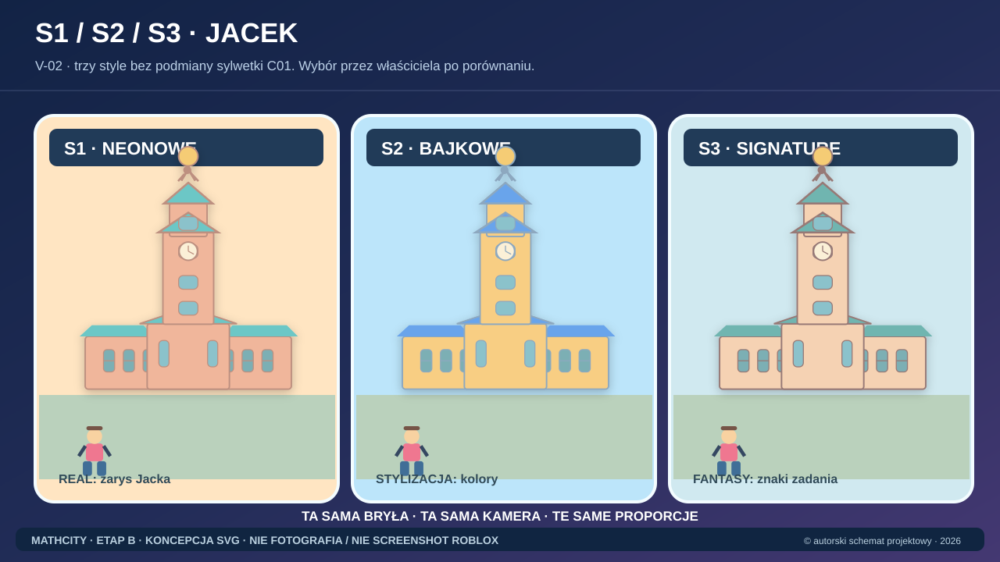
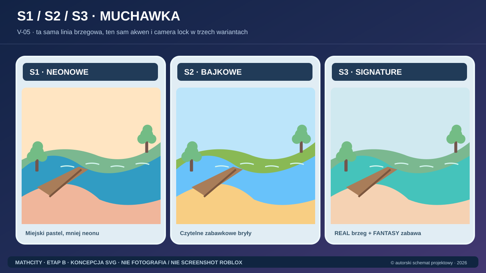

# MathCity — ETAP B: wejście i faktyczny stan

**Stan: 2026-10-19.** Zakres: Art Bible, trzy style, wygląd siedmiu proponowanych stref, postacie, pojazdy, UI, oświetlenie, modułowe assety i wizualizacje. **Faza dokumentacyjna.** Nie zmieniamy `MathCity.rbxl`, `src/` ani `assets/`.

## Stan Etapu A (zależność)
Desk research **41 POI, 10 priorytet A, 40 propozycji minigier**, propozycja **7 stref**; Etap A **PARTIAL, nie PASS**. Zdjęcia z licencjami, potwierdzenie lokalizacji Górki Grześ N07 i akceptacja masterplanu pozostają otwarte. [Indeks A](../world/STAGE_A_README.md) · [Atlas](../world/atlas/LANDMARK_CATALOG.md) · [Muchawka N01](../world/atlas/MUCHAWKA_FEATURE.md).

## Galeria referencyjna, obowiązkowa przed zleceniami

**[OTWÓRZ: GALERIA 17 ORYGINALNYCH OBRAZÓW SVG](VISUAL_REFERENCE_ATLAS.md)**. Dwie kontrolowane plansze S1–S3, trzy światła, siedem stref, Jacka, Muchawkę, Sekułę, sport, UI, NPC, modułowy kit i matematykę. Są to **obrazy pomocnicze**, nie końcowe screenshoty gry ani fotografie. [Manifest](concepts/README.md).

## Pierwszy plik dla słabszego modelu

**[STAGE_B_WEAK_LLM_RUNBOOK.md](STAGE_B_WEAK_LLM_RUNBOOK.md)** — procedura KROK PO KROKU. Następnie [TASK_PACKETS.md](TASK_PACKETS.md) — mikro-zadania, po jednym na wywołanie agenta. Model nie może zaznaczyć DONE tylko dlatego, że przeczytał dokumentację.

## Indeks wyników / status faktyczny

| Kod | Zadanie | Gdzie wynik | Status obecny |
|---|---|---|---|
| B0 | Struktura i reguły | ten plik, Runbook, Source Register | DOCUMENTED |
| B1 | Style i porównanie | [STYLE_VARIANTS](STYLE_VARIANTS.md), [CONCEPT_PROMPT_LIBRARY](CONCEPT_PROMPT_LIBRARY.md), [galeria](VISUAL_REFERENCE_ATLAS.md) | 2 SVG TRIPTYCHS / RENDERS_NOT_DONE |
| B2 | Art Bible dla 7 stref | [ART_BIBLE](ART_BIBLE.md), [DISTRICT_LOOKDEV](DISTRICT_LOOKDEV.md), [galeria](VISUAL_REFERENCE_ATLAS.md) | SVG REFERENCES / OWNER_REVIEW |
| B3 | NPC i pojazdy | [CHARACTER_AND_VEHICLES](CHARACTER_AND_VEHICLES.md) | DOCUMENTED / DESIGNS_NOT_RENDERED |
| B4 | Dzień, zachód, noc | [LIGHTING_LOOKDEV](LIGHTING_LOOKDEV.md) | DOCUMENTED / ROBLOX_NOT_TESTED |
| B5 | 23 kadry | [CONCEPT_SHOTS](CONCEPT_SHOTS.md), [SHOT_CARDS_V01_V23](SHOT_CARDS_V01_V23.md), [galeria](VISUAL_REFERENCE_ATLAS.md) | 23 CARDS / 17 SVG GUIDES / 0 FINAL RENDERS |
| B6 | Modularne rodziny assetów | [MODULAR_ASSET_GUIDE](MODULAR_ASSET_GUIDE.md) | DOCUMENTED / 0 MODELS |
| B7 | UI PC, telefon, tablet | [UI_VISUAL_GUIDE](UI_VISUAL_GUIDE.md) | DOCUMENTED / MOCKUPS_NOT_DONE |
| B8 | QA i akceptacja | [VISUAL_REVIEW](VISUAL_REVIEW.md) | REVIEW_REQUIRED / NOT_PASS |

Dodatkowo: [źródła i fakty](SOURCE_REGISTER.md), [manifest obrazów](concepts/README.md), [globalny masterplan](../world/DISTRICTS_MASTERPLAN.md), [skala Roblox](../tech/LARGE_WORLD.md), [prawa](../legal/RIGHTS_AND_COMPLIANCE.md).

## Definicja ETAP B DONE

1. 3 style S1/S2/S3 na **DWÓCH IDENTYCZNYCH widokach**: C01 i N01, co najmniej 6 rzeczywistych plików z kontrolą identycznego kadru, nie tylko promptów.
2. 10 głównych kadrów V01–V10 wizualnie ocenionych; reszta V11–V23 z kartami i jawnymi blokadami, dodatkowe obrazy według priorytetu.
3. Jeden wybrany (lub porównany) styl miasta spójny na **siedmiu** strefach, wraz z Sekułą (zima/lato), Muchawką, stadionem, krytym basenem i dworcem.
4. Charakterystykę zabytków potwierdza realny link; licencja do zdjęcia nie jest domyślna.
5. Porównanie L1/L2/L3 tej samej sceny + plany mobilnej czytelności.
6. Dokumenty postaci, pojazdów, UI i modularnych assetów bez naruszania istniejącej gry.
7. [VISUAL_REVIEW](VISUAL_REVIEW.md) ma rzeczywiste dowody i podpis decyzji właściciela.

**Na ten moment: `STAGE_B_DOCUMENTATION_READY / 17_SVG_REFERENCES_READY / 0_FINAL_RENDERS / STAGE_B_OWNER_REVIEW_REQUIRED`. Nie wpisywać PASS.**

## Reguły praw autorskich i dowodów

- Obrazy z internetowych portali są wyłącznie referencją LINK_ONLY i prawami UNKNOWN, bez pobierania/kopiowania.
- Sztuczny render nie jest fotografią Siedlec ani dowodem testu w Roblox.
- Używaj źródeł `L01–L14` i `R01–R17` z [SOURCE_REGISTER](SOURCE_REGISTER.md), nie wymyślaj szczegółów.
- Jeżeli nie masz generatora obrazów, pozostaw opisy i prompty, status `PROMPT_READY_IMAGE_NOT_GENERATED`. Nie twórz pustych PNG.

## Następna operacja wykonawcza

Wyślij do lekkiego LLM [Task Packets](TASK_PACKETS.md), mikro-zadanie B1-1. Daj mu **jedno zadanie na raz**, nie cały projekt. Po zakończeniu porównawczych ujęć owner wybiera kierunek zanim ruszy masowa produkcja pozostałych wizualizacji.
