# MathCity · Galeria 17 referencji Etapu B

**Stan: 2026-10-19.** To **17 rzeczywistych, oryginalnych obrazów wektorowych SVG**, wykonanych jako pomoc dla słabszych LLM. Są na zdalnym repo GitHub w `docs/art/concepts/`. **Nie są** fotografiami Siedlec, zrzutami Roblox, wysokiej jakości renderami UE ani ostatecznymi modelami zabytków. Zanim zbudujesz konkretny obiekt, sprawdź jego źródła [L01–L14](SOURCE_REGISTER.md) i karty Etapu A. Wymiary, proporcje i układ przestrzenny na SVG są **KONCEPCYJNE**.

## Instrukcja dla wykonawcy

1. Przy pracy nad kadrem V-xx najpierw znajdź jego referencję w tabeli poniżej, potem przeczytaj [karty V01–V23](SHOT_CARDS_V01_V23.md).
2. **Obowiązkowo obejrzyj SVG** (w GitHub jest podgląd). Sam odczyt nazwy pliku nie jest obejrzeniem grafiki.
3. Zastosuj kształty, paletę i oznaczenia REAL/FANTASY. Przy rzeczywistym budynku zawsze porównaj z oficjalnymi materiałami fotograficznymi z [PHOTO_REFERENCES](../world/atlas/PHOTO_REFERENCES.md).
4. Jeśli bez narzędzia obrazowego nie da się wykonać realistycznego/renderowanego kadru, odnotuj `PROMPT_READY_IMAGE_NOT_GENERATED`. 17 SVG to **referencje pomocnicze**, a nie zamiennik docelowych V01–V23.
5. Oznaczenie `REFERENCE_OPEN` lub `BLOCKED_GEOLOCATION` jest zakazem zgadywania realnej geometrii.
6. **Nie kopiować chronionych fotografii z portali do repo** i nie traktować zdjęcia z linku jako licencji na użycie.

## Mapa referencji i zastosowań

| Plik SVG | Właściwy temat | Po co | Warunek bezpieczeństwa |
|---|---|---|---|
| [REF00_WORLD_7_ZONES.svg](concepts/REF00_WORLD_7_ZONES.svg) | V-01 / masterplan | Siedem proponowanych stref, w tym Sekuła; skróty dróg są fikcyjne. | Siedem nazw, brak geografii 1:1 |
| [REF01_C01_JACEK_SILHOUETTE.svg](concepts/REF01_C01_JACEK_SILHOUETTE.svg) | C01 / V-02 | Szkic sylwetki ratusza: wieża o dwóch członach, figura Atlasa i boczne pawilony. | To artystyczny schemat, nie fotogrametria |
| [REF02_N01_MUCHAWKA_HUB.svg](concepts/REF02_N01_MUCHAWKA_HUB.svg) | N01 / V-05, V-18, V-19, V-22 | Jeden duży akwen z plażą, promenadą, pomostem, groblą i ochroną Doliny. | MW-01..06 fikcyjne, N01 nie jest S02 |
| [REF03_C01_STYLE_TRIPTYCH.svg](concepts/REF03_C01_STYLE_TRIPTYCH.svg) | S1–S3 / C01 | Trzy palety na jednej bryle Jacka, do oceny stylu. | Nie wystawiać ocen bez porównania z prawdziwymi zdjęciami |
| [REF04_N01_STYLE_TRIPTYCH.svg](concepts/REF04_N01_STYLE_TRIPTYCH.svg) | S1–S3 / N01 | Wspólna linia brzegowa w trzech stylach. | Nie dodawać egzotycznych realnych wysp |
| [REF05_C01_LIGHTING_L1_L2_L3.svg](concepts/REF05_C01_LIGHTING_L1_L2_L3.svg) | L1–L3 / V-03 | Ten sam kadr, różne światło: dzień, zachód, noc. | Nie nazywać renderem Roblox |
| [REF06_C02_C03_ALEKSANDRIA.svg](concepts/REF06_C02_C03_ALEKSANDRIA.svg) | C02/C03/C04 / V-04 | Klasycystyczny portyk, alejki, staw i mostek jako kierunek kadru. | Kolory i proporcje to koncepcja |
| [REF07_N04_N05_SEKULA_SEASONS.svg](concepts/REF07_N04_N05_SEKULA_SEASONS.svg) | N04/N05/N06 / V-11, V-12 | Zestaw lato/zima, narciarstwo biegowe i leśna edukacja. | Brak stoku zjazdowego i zabawy w miejscach pamięci |
| [REF08_S01_S02_S03_SPORT.svg](concepts/REF08_S01_S02_S03_SPORT.svg) | S01/S02/S03 / V-07, V-14–V-16 | Trzy różne obiekty: piłka, hala basenowa, lekkoatletyka. | Nie scalać do jednej rzeczywistej budowli |
| [REF09_MW04_FRACTION_ISLANDS.svg](concepts/REF09_MW04_FRACTION_ISLANDS.svg) | MW-04 / V-21 | W pełni fantastyczne wyspy i most matematyczny. | Wyspy nie są autentycznym Zalewem Muchawka |
| [REF10_MODULAR_ASSET_KIT.svg](concepts/REF10_MODULAR_ASSET_KIT.svg) | V-10 / B6 | Dwanaście modułów: dachy, okna, fasady, drzewa, oznaczenia i inne. | To schemat, nie pliki FBX |
| [REF11_NPCS_VEHICLES.svg](concepts/REF11_NPCS_VEHICLES.svg) | B3 | Sześć typów NPC i siedem pojazdów, jedna rodzina stylistyczna. | Brak marek, prawdziwych logotypów i gotowych modeli |
| [REF12_UI_PC_MOBILE_SAFEAREA.svg](concepts/REF12_UI_PC_MOBILE_SAFEAREA.svg) | V-09 / B7 | Porównanie desktop/telefon z wydzieleniem joysticka, skoku, zadań. | Makieta UI, bez testu na kliencie Roblox |
| [REF13_MATH_MINIGAME_VISUALS.svg](concepts/REF13_MATH_MINIGAME_VISUALS.svg) | B5 / edukacja | Matematyka przez siedzenia, zegar, połówki i pieniądze. | Warianty klas podlegają recenzji dydaktycznej |
| [REF14_T01_KOLEJOWO_REFERENCE_OPEN.svg](concepts/REF14_T01_KOLEJOWO_REFERENCE_OPEN.svg) | T01/T02 / V-06 | Kompozycja sceny dworca i fikcyjnego transportu. | Fasada rzeczywistego dworca = REFERENCJE OPEN |
| [REF15_D6_CULTURE_RESPECT.svg](concepts/REF15_D6_CULTURE_RESPECT.svg) | D6 / V-08 | Zróżnicowane obiekty kultury i spokojny kontekst miejskiego dziedzictwa. | Nie traktować narysowanych fasad jako konkretnych autentycznych instytucji |
| [REF16_V01_PANORAMA_ART_DIRECTION.svg](concepts/REF16_V01_PANORAMA_ART_DIRECTION.svg) | V-01 / wizja | Przykład kolorystyki miejskiej panoramy i hierarchii landmarków. | Nie jest geograficznym planem Siedlec |

## Galeria: wygląd świata, landmarków i dzielnic

### V-01 / masterplan

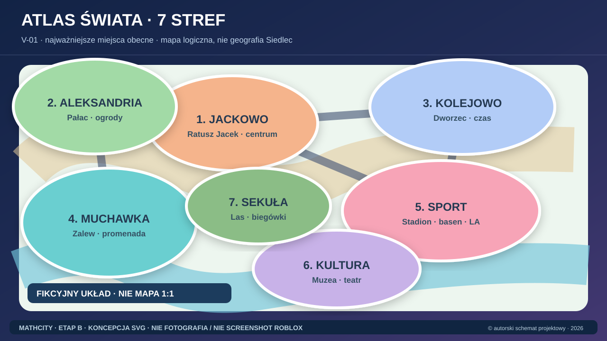

### C01 / V-02

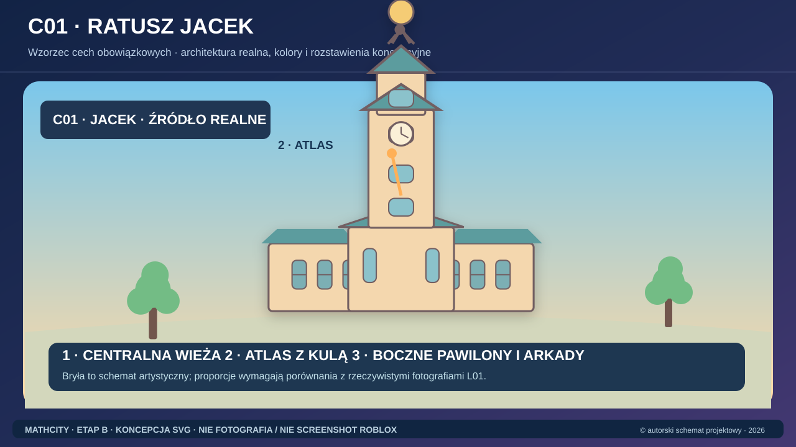

### N01 / V-05, V-18, V-19, V-22

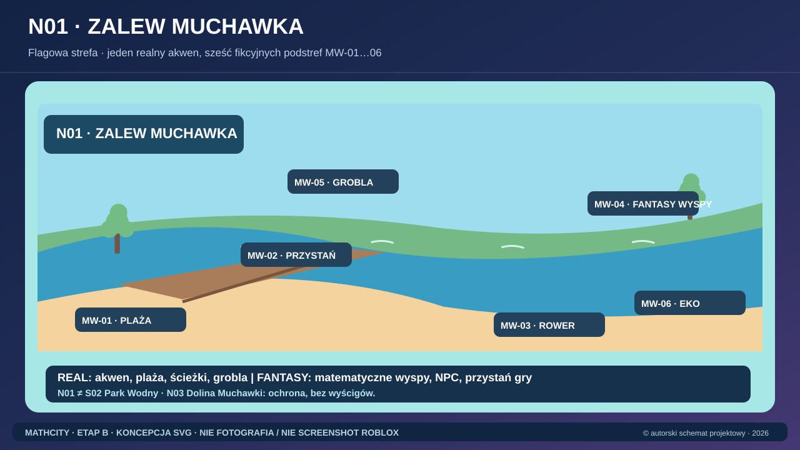

### S1/S2/S3 na Jacku, a potem na Muchawce

### Jedna geometria, trzy pory dnia

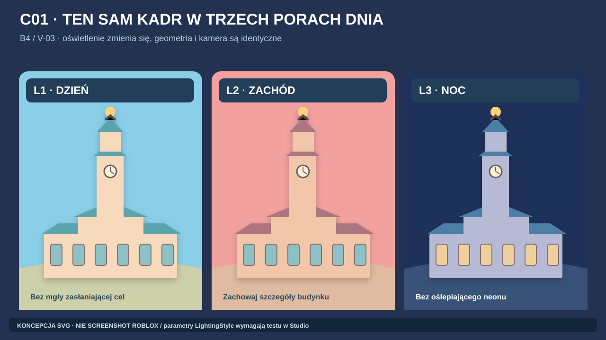

## Galeria: siedem stref, bez wymyślania lokalizacji

### C02/C03/C04 / V-04

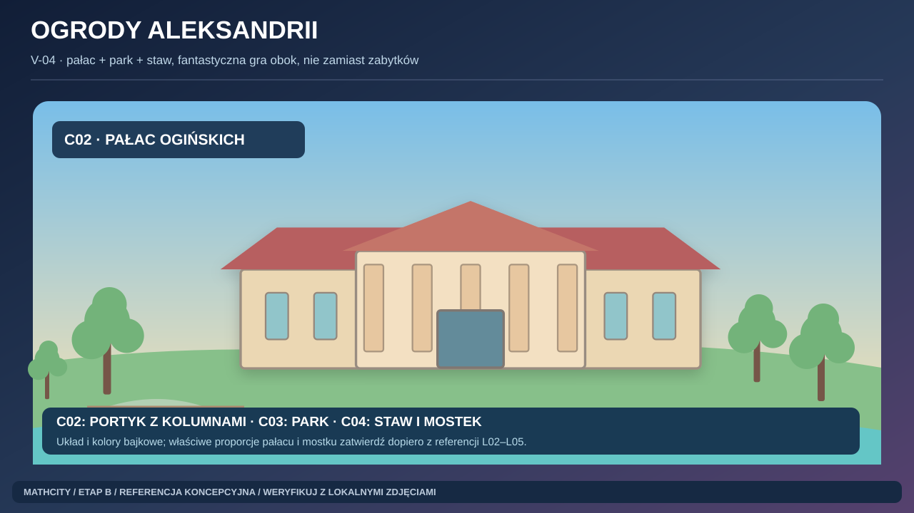

### N04/N05/N06 / V-11, V-12

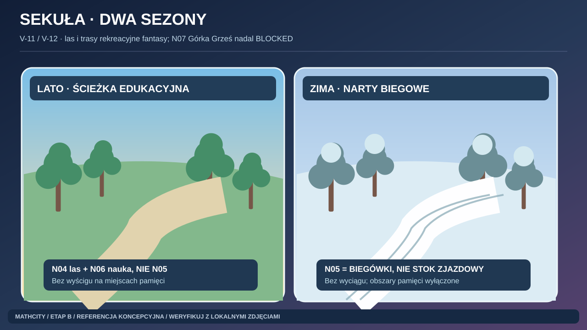

### S01/S02/S03 / V-07, V-14–V-16

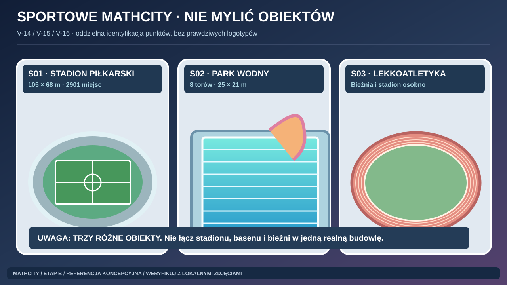

### MW-04 / V-21

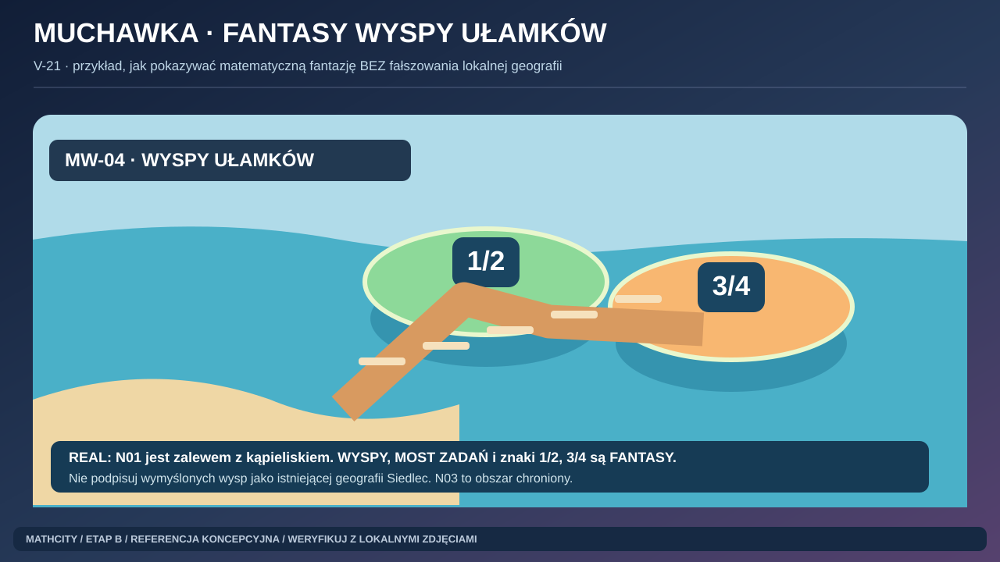

### T01/T02 / V-06

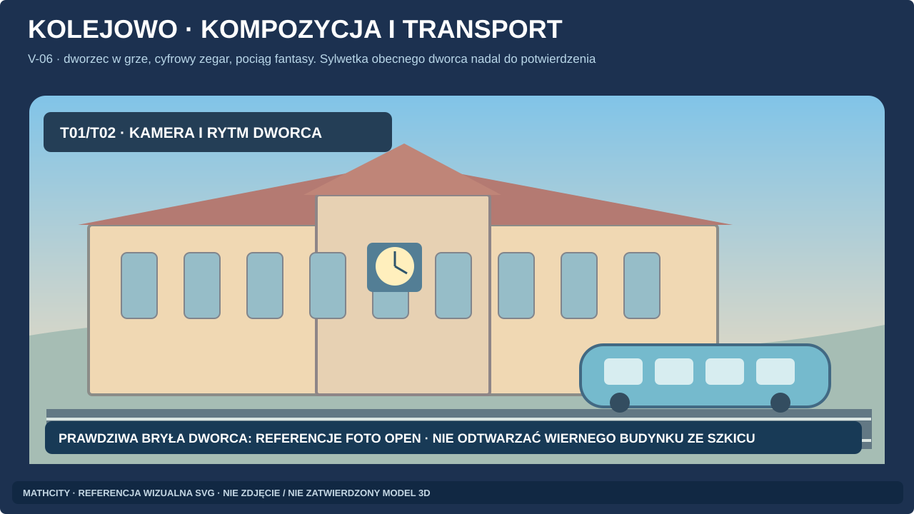

### D6 / V-08

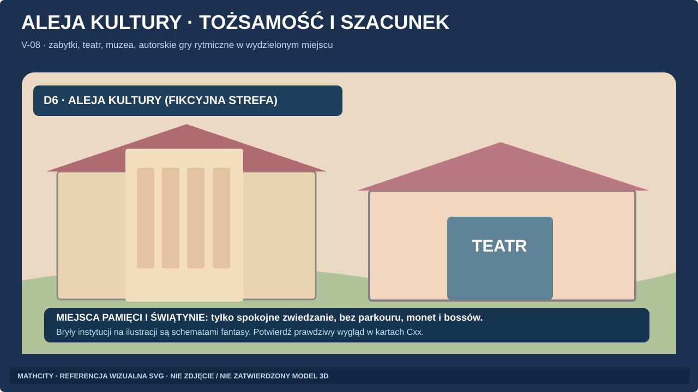

### V-01 / wizja

## Galeria: produkcja artystyczna i game design

### V-10 / B6

### B3

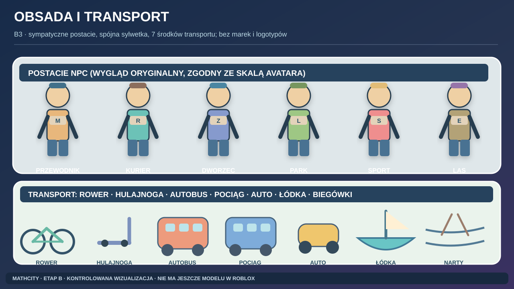

### V-09 / B7

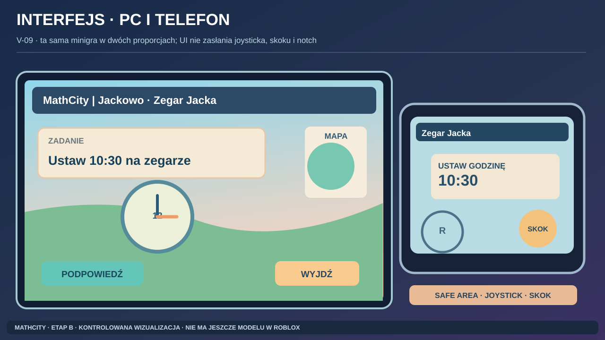

### B5 / edukacja

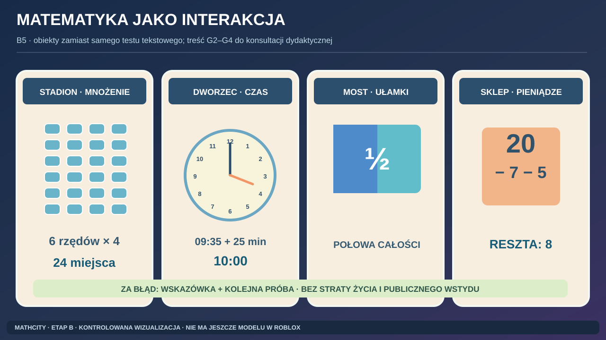

## Którą referencję otworzyć dla danego V-ID?

| V-ID | Referencja obowiązkowa (otwórz obraz) | Uwagi |
|---|---|---|
| V-01 | [REF00](concepts/REF00_WORLD_7_ZONES.svg), [REF16](concepts/REF16_V01_PANORAMA_ART_DIRECTION.svg) | 7 stref; szkic bez geolokalizacji |
| V-02 | [REF01](concepts/REF01_C01_JACEK_SILHOUETTE.svg), [REF03](concepts/REF03_C01_STYLE_TRIPTYCH.svg) | C01 + źródło L01 |
| V-03 | [REF05](concepts/REF05_C01_LIGHTING_L1_L2_L3.svg) | to samo ujęcie, tylko światło |
| V-04 | [REF06](concepts/REF06_C02_C03_ALEKSANDRIA.svg) | L02–L05 |
| V-05 | [REF02](concepts/REF02_N01_MUCHAWKA_HUB.svg), [REF04](concepts/REF04_N01_STYLE_TRIPTYCH.svg) | N01 REAL + podstrefy FANTASY |
| V-06 | [REF14](concepts/REF14_T01_KOLEJOWO_REFERENCE_OPEN.svg) | prawdziwa fasada dworca OPEN |
| V-07 | [REF08](concepts/REF08_S01_S02_S03_SPORT.svg) | S01/S02/S03 osobno |
| V-08 | [REF15](concepts/REF15_D6_CULTURE_RESPECT.svg) | fasady realne wymagają źródeł |
| V-09 | [REF12](concepts/REF12_UI_PC_MOBILE_SAFEAREA.svg) | safe areas PC i mobile |
| V-10 | [REF10](concepts/REF10_MODULAR_ASSET_KIT.svg) | modułowość, nie FBX |
| V-11 | [REF07](concepts/REF07_N04_N05_SEKULA_SEASONS.svg) | biegówki zimą |
| V-12 | [REF07](concepts/REF07_N04_N05_SEKULA_SEASONS.svg) | las latem |
| V-13 | **BRAK WIARYGODNEJ REFERENCJI** | N07 BLOCKED_GEOLOCATION |
| V-14 | [REF08](concepts/REF08_S01_S02_S03_SPORT.svg) | S01 stadion piłkarski |
| V-15 | [REF08](concepts/REF08_S01_S02_S03_SPORT.svg) | S02 hala basenowa |
| V-16 | [REF08](concepts/REF08_S01_S02_S03_SPORT.svg) | S03 lekkoatletyczny |
| V-17 | [REF00](concepts/REF00_WORLD_7_ZONES.svg), [REF07](concepts/REF07_N04_N05_SEKULA_SEASONS.svg) | oś zielona fantasy |
| V-18 | [REF02](concepts/REF02_N01_MUCHAWKA_HUB.svg) | panorama |
| V-19 | [REF02](concepts/REF02_N01_MUCHAWKA_HUB.svg), [REF13](concepts/REF13_MATH_MINIGAME_VISUALS.svg) | perspektywa dziecka |
| V-20 | [REF02](concepts/REF02_N01_MUCHAWKA_HUB.svg), [REF13](concepts/REF13_MATH_MINIGAME_VISUALS.svg) | triathlon fantasy |
| V-21 | [REF09](concepts/REF09_MW04_FRACTION_ISLANDS.svg) | wyspy fantasy, nie realne |
| V-22 | [REF02](concepts/REF02_N01_MUCHAWKA_HUB.svg) | N03 pod ochroną |
| V-23 | [REF02](concepts/REF02_N01_MUCHAWKA_HUB.svg), [REF05](concepts/REF05_C01_LIGHTING_L1_L2_L3.svg) | światło nocy jako zasada, NIE gotowy render nocnej Muchawki |

## Weryfikacja kontrastowa dla słabego modelu

**NIE DOWIÓZŁ**, jeżeli:
- z 7 dzielnic zrobił 6 albo zamienił Sekułę w niezdefiniowany las;
- wykonał ratusz jak dowolną katedrę bez Atlasa;
- narysował Most Wysp Ułamków i podpisał jako prawdziwy most na Muchawce;
- pomieszał dwa stadiony lub zalew z basenem;
- udawał, że V-13 ma prawdziwą lokalizację;
- oznaczył SVG jako screenshot Roblox lub zdjęcie;
- przepisał obrazy AI z błędną polską typografią jako gotowy interfejs.

**Ważne:** w tym pakiecie jest 17 **obrazów SVG** i **zero finalnych renderów 3D / zero finalnych zrzutów Roblox**. Zgodnie z [VISUAL_REVIEW](VISUAL_REVIEW.md) nie oznacza to `STAGE_B_PASS`.
