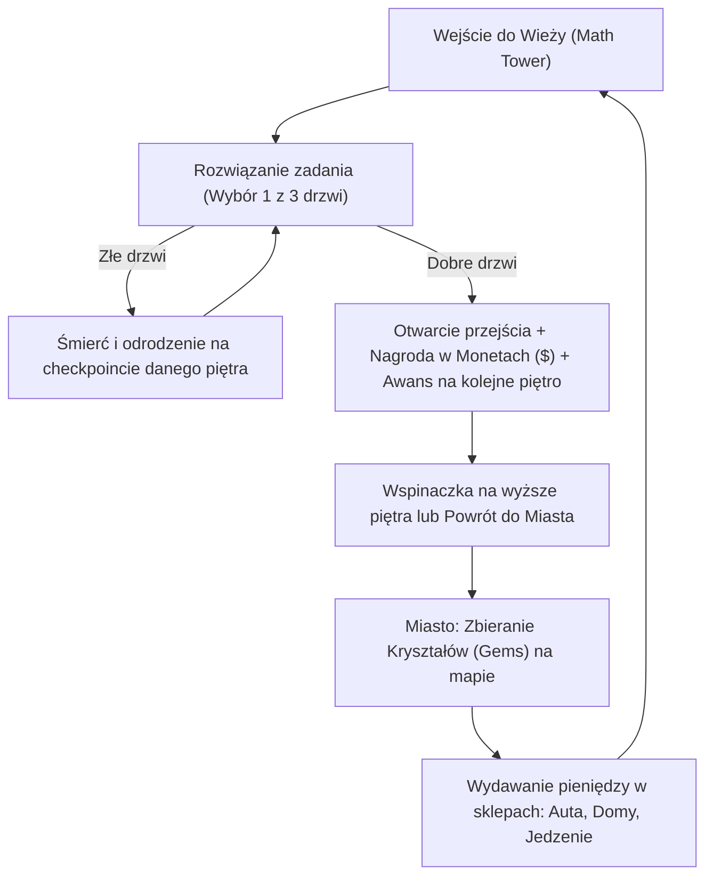

# Archiwum: GDD prototypu Wieży Matematycznej (v1)

**Uwaga:** dokument historyczny. Aktualna wizja MathCity znajduje się w [../GDD.md](../GDD.md), a lista decyzji w [../planning/DECISION_LOG.md](../planning/DECISION_LOG.md).

---

# 🎮 Game Design Document (GDD) — Math City

## 1. Informacje Ogólne
* **Tytuł gry:** *Math City*
* **Platforma:** Roblox (PC, Mac, Mobile, Tablet, Konsola)
* **Gatunek:** Edukacyjne Obby / Tower / Otwarty Świat (Roleplay & Tycoon)
* **Grupa docelowa:** Dzieci ze szkoły podstawowej (klasa 3) oraz fani gier typu obby i Brookhaven.
* **Główny cel:** Nauka tabliczki mnożenia i kolejności działań poprzez angażującą rozgrywkę z nagrodami w postaci aut, domów i supermocy.

---

## 2. Główna Pętla Rozgrywki (Core Game Loop)

---

## 3. Szczegółowe Mechaniki Gry

### A. Wieża Matematyczna (Math Tower)
1. **Piętra Wieży:**
   * Każde piętro to osobna platforma z 3 drzwiami (`Door1`, `Door2`, `Door3`) oraz tablicą nad nimi (`Sign`).
   * Gracz widzi działanie (np. $8 \times 6 = ?$) i trzy warianty odpowiedzi (np. $42$, $48$, $54$).
2. **Zachowanie Drzwi:**
   * **Poprawne drzwi:** Po dotknięciu stają się przezroczyste i tracą kolizję (`CanCollide = false`), odtwarza się radosny dźwięk, a gracz otrzymuje monety i odblokowuje kolejny checkpoint.
   * **Błędne drzwi:** Po dotknięciu natychmiast resetują zdrowie gracza do zera (`Humanoid.Health = 0`).
3. **Respawny (Checkpointy):**
   * Gracz nigdy nie cofa się na start gry. Odradza się na checkpoincie odpowiadającym jego wartości `Stage` w tabeli wyników.

### B. Miasto (Hub)
1. **Zbieranie Kryształów (Gems):**
   * Błękitne, świecące kryształy lewitują i obracają się w różnych zakamarkach miasta (dachy budynków, park, fontanny).
   * Zebranie daje graczowi kryształ do statystyk i uruchamia 15-sekundowy czas odnowienia (respawn).
2. **Sklep Motoryzacyjny:**
   * Kupowanie samochodów za monety ($) zarobione w wieży.
   * Auta pozwalają na szybsze przemieszczanie się po mieście i dojazd do wieży.
3. **Osiedle Domów:**
   * Możliwość odblokowania własnej działki z domem.
4. **Sklep Spożywczy:**
   * Jedzenie (np. pizza, jabłko, napój energetyczny) po zjedzeniu daje tymczasowy efekt (np. +50% do prędkości biegu na 60 sekund).

---

## 4. Ekonomia i Waluty

| Waluta | Ikona | Skąd zdobyć? | Na co można wydać? |
| :--- | :---: | :--- | :--- |
| **Monety ($)** | 🪙 | Nagroda za poprawne przejście piętra w wieży | Samochody, domy, jedzenie, akcesoria |
| **Kryształy** | 💎 | Zbieranie po zakątkach miasta (parki, dachy) | Rzadkie zwierzaki (pety), unikalne szlaki (trails), skórki |

---

## 5. Monetyzacja & Admin Panel

### Gamepass: **👑 Admin Panel (500 Robux)**
* Dostępny do kupienia za 500 Robux dla innych graczy.
* **Darmowy dla Was** (właściciela gry i współtwórców).
* **Zawiera supermoce:**
  * 🪽 **Fly (Latanie):** Dowolny lot w 3D sterowany klawiszami (WASD + Spacja/Shift).
  * 👻 **Noclip (Przenikanie przez ściany):** Przechodzenie przez każdą ścianę i zamknięte drzwi.
  * ⚡ **Super Speed:** Zwiększenie prędkości biegu do 60 (standard to 16).
  * 🛡️ **God Mode:** Całkowita odporność na śmierć od błędnych drzwi.
  * 💰 **Test Cash:** Błyskawiczne dodawanie waluty do testów.